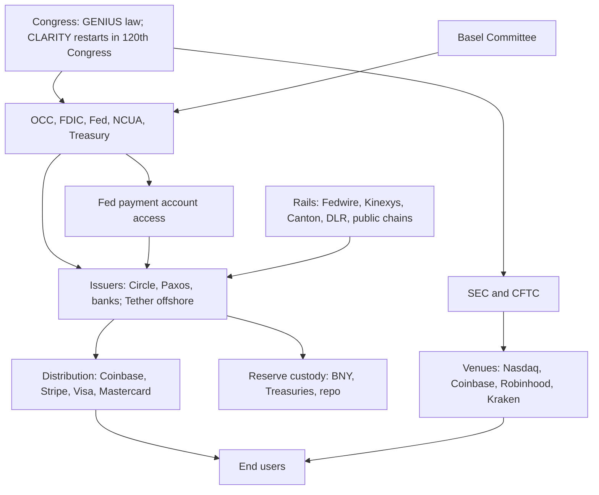

# Programmable Ledgers, Digital Money, and the Investment Map

Research date: 2026-11-04. Status: v2, revised after Phase 4 verification and the Phase 5 red teams. Every change is logged in `changelog.md`; v1 is preserved at `data/REPORT_v1.md`.

## Executive summary

**Is it happening?** Yes, on regulated and permissioned rails. Barely, on public-chain tokenization. Not yet in payments or retail CBDCs.

- Fact: USD stablecoin supply is $295.1B (DefiLlama API, 2026-11-04). It is 3.0% lower than 12 months ago, at a joint low in the crypto price and interest-rate cycle (Section 4A).
- Fact: Tokenized Treasuries and money funds on public chains are $14.25B (RWA.xyz, 2026-11-04) [Interested source]. That is 0.18% of US money fund assets ($7.90T, ICI, 2026-10-28).
- Fact: Assets recorded on permissioned ledgers are much larger. RWA.xyz counts $396B of represented value, mostly on Canton. Broadridge's DLR platform runs about $359B of repo a day (2026-09) [Interested source].
- Inference: No market segment passes the rejection test in `null_hypothesis.md`. Wholesale repo on ledgers is the segment closest to passing, if self-reported operator volumes are accepted. [Moderate]

**How likely?** The lead estimate is a five-estimator panel: the model base run, the model's drivers-only run, WS3 judgment, Red Team A and Red Team B.

| Scenario | 2030 | Panel range | 2035 | Panel range |
|---|---|---|---|---|
| Bear: public-chain tokenization and stablecoins stay niche | 51% | 38% to 64% | 46% | 30% to 67% |
| Base | 42% | 28% to 54% | 43% | 26% to 55% |
| Bull | 7% | 5% to 11% | 11% | 7% to 15% |

- Confidence: [Low]. Inside Bear sits a disorderly sub-path of about 10% over five years: a run, a large theft or a sanctions shock followed by a clampdown (Section 4B).
- Fact: The binding constraints are demand and macro, not law. GENIUS is law (effective 2027-01-18). Market structure legislation failed cloture 49 to 50 (2026-09-15). Democrats won both chambers on 2026-11-03 (AP calls via CBS News, 2026-11-04).
- Fact: The Fed raised its target range to 3.75% to 4.00% on 2026-09-16 and held on 2026-10-28. September CPI was 3.7% (secondary reports of BLS data, 2026-10-14). [Moderate]

**Who wins?** Owners of distribution, licences and balance sheets.

- Fact: Circle's distribution and transaction costs were 62% of its Q3 2026 reserve income ($409.2M of $657.6M, Circle Q3 2026). Ethereum gross fee revenue was $127M in H1 2026.
- Inference: Tokens capture value only where a chain owns order flow or a dominant stablecoin corridor (Tron, Hyperliquid). That capture is fragile because governance can switch it off. [Moderate]

**Top five plays per tier.** Ranking is by central excess return over T-bills (4.21%, 3-month constant maturity, H.15, 2026-11-02), shown with stress drawdown. Rows marked (J) are judgment overrides of the score.

| Rank | Retail | Mid (accredited) | Large ($5M and up) |
|---|---|---|---|
| 1 | Visa, Mastercard (R-09, R-10, A-01, A-02): +4.3 to +4.8 pts; stress 50% to 60% [Moderate] | Tokenized private credit, held through the conventional fund where possible (M-08): +3.3 pts; stress 30%; quarterly gates (J) [Low] | Buy a licensed issuer with distribution (L-02): +4.7 pts; stress 80% [Low] |
| 2 | BNY (R-12): +3.8 pts; stress 65% [Low] | Ripple secondary (M-02): +11.2 pts. It is an XRP proxy (J) [Low] | Anchor a tokenized MMF launch (L-03): cash yield plus strategic access; -0.4 pts (J) [Low] |
| 3 | BlackRock (R-18): +3.3 pts; stress 60% [Low] | Kraken secondary (M-01): +6.7 pts; mark disputed, Forge $9.93B vs Series E $21B [Low] | Custody build or buy (L-06): unscored (J) [Unverified] |
| 4 | Circle (R-01): +3.3 pts; stress 83%; sized as an option [Low] | Anchorage (M-04): +3.1 pts [Low] | Digital Asset (Canton) equity or partnership, repriced from the 2026 round (M-06, L-04 revised) (J) [Low] |
| 5 | ICE, State Street, Franklin (R-16, R-13, R-19): +2.8 pts; stress 65% to 80% [Low] | Venture funds (M-07): +2.4 pts; 10-year lockup [Unverified] | Tokenized-deposit partnership (L-05): unscored (J) [Unverified] |

- Inference: Every crypto-native public equity except Circle scores below T-bills on central estimates (COIN, HOOD, GLXY, BLSH, FIGR, GEMI). So do token ETPs except staked ETH. Their case rests on the Bull tail and on token-price cycles, not on the adoption evidence. [Moderate]

**Recommendation.** For the theme, own the incumbents that collect tolls on the regulated path. Keep issuer, distributor and token exposure as small, capped options. Hold the rest in T-bills, which pay a real yield of about 0.5% against 3.7% CPI. [Moderate]

---

## 1. Adoption: what the data show (WS0)

| Measure | Value | Date | Comparator | Penetration | Source | Confidence |
|---|---|---|---|---|---|---|
| USD stablecoin supply | $295.1B (peak $315.5B on 2026-05-17; the all-stablecoin series peaked at $322.4B on 2026-05-26) | 2026-11-04 | US MMF assets $7.90T | 3.7% | DefiLlama API; ICI; Crypto Briefing | [High] |
| Real stablecoin payments | $0.39T annualized | 2025-12 | ACH $93.0T (2025) | 0.4% | McKinsey/Artemis via secondary [Interested source]; Nacha | [Moderate] |
| Visa-adjusted stablecoin volume | $12.0T (raw $63.0T) | 2026-01 to 08 | | | Visa/Allium via secondary [Interested source] | [Low] |
| Tokenized Treasuries and MMFs (distributed) | $14.25B | 2026-11-04 | US MMF assets | 0.18% | RWA.xyz [Interested source]; ICI | [Moderate] |
| All tokenized assets excluding stablecoins (distributed) | $39.4B | 2026-11-04 | | | RWA.xyz | [Moderate] |
| Represented assets (permissioned ledgers, mainly Canton) | $396B | 2026-11-04 | | | RWA.xyz | [Moderate] |
| Broadridge DLR repo | about $359B per day | 2026-09 | | | Broadridge, self-reported [Interested source] | [Low] |
| Kinexys | over $7B per day | 2026-06 | RTP about the same daily value | | JPMorgan via CoinDesk [Interested source] | [Low] |
| FedNow plus RTP | about $0.99T | Q3 2026 | | | Federal Reserve; The Clearing House | [Moderate] |

- Inference: Two adjusted measures of stablecoin payments differ by about 46x. Adoption claims built on any single dashboard are unreliable. [High]
- Inference: Supply is a stock, not a usage measure. Supply on Tron and Ethereum reflects where balances are parked, not where payments occur.
- Inference: Represented assets are records on a ledger, not settlement in central bank money. DTC gives tokenized positions no collateral value in its own risk management (Red Team B). [Moderate]
- Inference: Fast conventional rails (FedNow, RTP, Pix, UPI) deliver speed and 24/7 operation without new ledgers. That is the counterfactual every DLT claim must beat. [Moderate]

## 2. Landscape (WS1)

| Category | Status | Example and latest metric | Binding constraint |
|---|---|---|---|
| Payment stablecoins | Live | USDC $73.9B (2026-09-30, Circle Q3) | Demand outside crypto trading; opportunity cost when rates rise |
| Offshore stablecoins | Live | USDT $177.8B (2026-11-04) | Reserve quality: about 0.74x of liabilities in high-quality assets (FEDS Note, 2026-04-08) |
| Tokenized MMFs | Live | BUIDL $1.97B; BENJI and iBENJI $2.7B (RWA.xyz, 2026-11-04) | Small yield edge over conventional money funds |
| Tokenized equities | Live, small | $3.89B; SEC innovation exemption 2026-09-17 to 2031-09-17 | Nasdaq tokenized trades still settle T+1 through NSCC/DTC |
| Wholesale DLT | Live inside single operators | DLR and Kinexys are live. DTCC ran live tokenized trades on Canton and Besu on 2026-07-15 (secondary, per Red Team B). Agora is a prototype (BIS, 2026-05-27). | Interoperability; final settlement in central bank money |
| Retail CBDC | 3 launched, 41 pilots | Atlantic Council, 2026-05 | Political opposition; weak usage |
| Agentic payments | Live, early | x402: $42M settled cumulatively; about $274k in October 2026 | Consumer protection and liability rules (WS8) |

## 3. Who sets the rules and builds the rails (WS2)

| Item | Status (2026-11-04) | Source | Confidence |
|---|---|---|---|
| GENIUS Act | Public Law 119-27, signed 2025-07-18, effective 2027-01-18 | govinfo | [High] |
| OCC GENIUS final rule | Issued 2026-10-21. Dropped the presumption that affiliate or white-label yield is prohibited. | OCC Bulletin 2026-50 via law-firm summaries | [Moderate] |
| Fed GENIUS rules | Proposed 2026-09-24; comments close 2026-11-30; the proposal keeps an affiliate-yield presumption | Federal Register via Arnold & Porter | [Moderate] |
| Fed payment accounts | Proposed limited-purpose account: no discount window, no interest, capped balances | CRS Insight IN12722 (2026-08-04), per Red Team A | [Moderate] |
| CLARITY Act | Passed the House 294 to 134; Senate Banking 15 to 9; cloture failed 49 to 50 (2026-09-15); must be reintroduced in the 120th Congress | Latham; Orrick | [High] |
| 2026 midterms | AP called both chambers for Democrats | CBS News, NBC, Forbes, 2026-11-04 | [Moderate] (seat counts provisional) |
| SEC tokenized-stock exemption | Release 34-106402, expires 2031-09-17 | SEC; Sidley | [Moderate] |
| Basel crypto standard | In force 2026-01-01; targeted review, with an update due by end 2026 | BIS, 2026-10-01 | [High] |
| Digital euro | Parliament voted 416 to 169 to open trilogue (2026-07-09); ECB target 2029 | Secondary | [Moderate] |

- Inference: Access to Fed accounts is the structural lever for issuers. Without a discount window, a stablecoin issuer remains a run-prone, narrow-bank-like liability. [Moderate]

- Gap: The UK, Hong Kong licensees, Singapore, Japan, the PBoC and the SNB were not verified (search cap). `institutions.csv` rows tagged Unverified are placeholders.

## 4. Scenarios, macro regime and model

### 4A. Macro regime (added in v2)

| Variable | Value | Date | Source | Effect on the theme |
|---|---|---|---|---|
| Fed target | 3.75% to 4.00%: hiked 2026-09-16, held 2026-10-28 with two dissents for a hike | 2026-10-28 | FOMC; secondary on the dissents | Raises issuer float income. It also raises the cost of holding non-yielding stablecoins, which shrank supply in 2022. |
| 3-month T-bill | 4.21% (constant maturity), above effective fed funds of 3.88% | 2026-11-02 | H.15; FRED | Markets lean toward a hike |
| CPI | 3.7% year on year | 2026-09 (released 2026-10-14) | Secondary reports of BLS | Real T-bill yield about 0.5% |
| Geopolitics | Iran war energy shock; post-election coverage links it to gas prices | 2026-11-04 | CBS News | Risk-off pressure on crypto liquidity |

- Inference: Rate sensitivity runs both ways. ±100 basis points moves Circle's gross reserve income by about ±$739M a year at $73.9B USDC (about ±$276M after distribution costs) before any supply response. Supply tends to fall when the opportunity cost rises, so a hike is less positive for issuers than this arithmetic shows. [Moderate]

### 4B. Scenario definitions

Measures: S = stablecoin supply; T = distributed tokenized assets excluding stablecoins; W = DLT share of wholesale flows. W is unmeasured, so classification uses S and T. A split outcome counts as Base.

| Scenario | 2030 band (WS3 recalibration) | 2035 band (schema) |
|---|---|---|
| Bear | S < $500B and T < $100B | S < $1T and T < $500B |
| Base | Otherwise | Otherwise |
| Bull | S > $1.5T and T > $500B | S > $4T and T > $5T |

- Inference: The 2030 bands were recalibrated after the current data were seen: the schema's Bull threshold needed 149% a year growth in T. That is a judgment call, flagged here.
- Inference: Bear is defined on public-chain T, so it means "public-chain tokenization stays niche," not "ledgers stay niche." On represented assets, T is $435B and already in the 2030 Base band. [Moderate]
- Disorderly sub-path: about 10% over five years (WS6 R22 7%; Red Team A 10% to 15%). It would shift market share and regulation abruptly. The plays hit hardest are CRCL, COIN, token ETPs and tokenized MMFs, through a temporary run.

### 4C. Panel results

| Estimator | 2030 Bear / Base / Bull | 2035 Bear / Base / Bull |
|---|---|---|
| Model base (blend growth, decay 0.8, midterm override) | 64 / 28 / 7 | 67 / 26 / 7 |
| Model, drivers only (no momentum) | 54 / 35 / 11 | 53 / 36 / 11 |
| WS3 judgment | 50 / 43 / 7 | 38 / 51 / 11 |
| Red Team A | 48 / 47 / 5 | 40 / 50 / 10 |
| Red Team B | 38 / 54 / 8 | 30 / 55 / 15 |
| **Panel mean (lead)** | **51 / 42 / 7** | **46 / 43 / 11** |

Model variants for 2030 Bear:

| Variant | 2030 Bear |
|---|---|
| 12-month growth (measured at the trough) | 73% |
| 36-month growth, decay 0.9 | 52% |
| T including represented assets | 50% |

- Inference: Momentum is pro-cyclical. The base model is most bearish at troughs, which is why it is one of five panel estimators and not the lead. [Moderate]
- Inference: The most influential drivers are regulatory clarity and end-user demand, about 3.7 points of Bear each per notch. Bank capital treatment and political durability come next. [Moderate]

**Leading indicators and falsifiers** (WS3):

| Scenario | Indicator to watch | Falsifier |
|---|---|---|
| Bear | DefiLlama stablecoin supply below $350B on 2027-12-31 | S above $500B or T above $100B by 2028-12-31 |
| Base | RWA.xyz tokenized Treasuries above $30B on 2027-12-31; final FDIC and Fed GENIUS rules by 2027-07-18 | S below $400B and T below $60B on 2028-12-31 |
| Bull | Stablecoins above $600B by 2028-06-30; Basel removes the penalty for permissionless chains | S below $600B on 2028-12-31 |

**Forecasts.**
- Fact: Sell-side marks include Standard Chartered at $2T of stablecoins by 2030 (moved from 2028), Citi at $5.5T tokenized by 2030 and BCG/Ripple at $18.9T by 2033. All come from interested parties [Interested source].
- Inference: These marks need 50% to 150% a year. WS3's range is about $450B to $1.1T of stablecoins and $100B to $300B of distributed T by 2030. [Low]

**Analogs.**
- Inference: Pix and UPI scaled in three to four years under central-bank mandate. Value went to distributors and users.
- Inference: The 2016 to 2020 voluntary consortia (we.trade, TradeLens, ASX CHESS replacement) failed. The current wave differs in one way: live single-operator platforms (DLR, Kinexys, Canton) now exist. [Moderate]

## 5. Where value accrues (WS4, revised with red-team counterexamples)

| Layer | Who wins | Pricing power 2030 | Confidence |
|---|---|---|---|
| Issuance and float | Tether (offshore), Circle; bank issuers and yield-sharing coalitions entering | Medium to low. Take rate is compressing (Open USD coalition, 2026-06-30). | [Moderate] |
| Distribution and wallets | Coinbase, Stripe, card networks, Robinhood | High | [Moderate] |
| Custody and reserves | BNY, State Street, Anchorage | Medium. Licences are commoditizing as more charters are granted. | [Low] |
| Settlement and clearing | DTCC, Broadridge, Digital Asset (Canton), Kinexys | Medium. Canton activity is concentrated in one application, DLR (Rosa and Roubini, 2026-05-21). | [Low] |
| Public L1 and L2 tokens | Mixed: Ethereum fees low; Tron about $3.5B of revenue in 2025 (secondary); Hyperliquid routes most perp fees to buybacks | Low on average, high where the chain owns order flow. Fragile: Tron's validators cut base fees 60% on 2025-08-29. | [Moderate] |
| Base (L2) | Coinbase equity today. A Base token, if launched, could move sequencer revenue to token holders. | Medium | [Low] |
| Tokenization platforms | Securitize, Ondo, Figure | Low to medium; products commoditize | [Low] |

- Fact: Stablecoin flows move T-bill yields. WS4 reads BIS Working Paper 1270 as about 0.7 basis points on impact for a $3.5B inflow. Red Team A cites the 2026-02 revision as 2.5 to 3.5 basis points for a two-standard-deviation inflow, with outflows two to three times larger and 5 to 8 basis points under bill scarcity. [Moderate, magnitudes contested]
- Inference: The asymmetry matters in a run more than in growth.
- Fact: Fee pools at risk by 2030 are modest. Cross-border revenue is $293B (McKinsey, 2024) [Interested source], with 1% to 4% at risk. US card swipe fees are $198B (2025) [Interested source], with 0.5% to 2% at risk. Interchange legislation is a larger risk to V and MA than stablecoins are (Red Team A item 12). [Moderate]

## 6. The plays (WS5, WS8, WS9; merged with WS7 tax)

The matrix has 75 rows in `plays.csv` and `plays.xlsx`: Retail 51, Mid 13, Large 11. Each row has a band, a central estimate, a stress drawdown, a tier rank, a tax character and a kill criterion.

**Method v2** (changelog C1, C2).
- Central estimate: each workstream band is read as roughly the 10th to 90th percentile of annual returns. The central estimate is the midpoint minus σ²/2, where σ = (high - low) / 2.563. This is the compounding drag for volatile assets.
- Ranking: plays are ranked within each tier by central excess return over 4.21%, with stress drawdown shown next to it. There is no ratio, because a ratio with a negative numerator ranks riskier assets higher.
- Stress drawdowns are anchored on 2008 to 2009 for incumbents: V 50%, MA 60%, BK 65%, STT and ICE 80%, BLK 60% [Unverified history]. Crypto anchors are in `data/drawdowns.csv`.
- Bands remain workstream judgment and mix one-year and multi-year framings. [Low]

**Valuation check** (WS5, stockanalysis.com, 2026-11-04):

| Ticker | Price | Market cap | Multiple | Note |
|---|---|---|---|---|
| CRCL | $76.51 | $19.5B | EV/S 5.9; forward P/E 60.8 | Reverse DCF needs about 16% revenue CAGR for a 10% return. About 74% below the $298.99 intraday peak of 2025-06-23. |
| COIN | $151.86 | $40.2B | EV/S 7.0; forward P/E 104.5 | Q3 revenue down 35% year on year (10-Q). Stablecoin revenue about $307M a quarter. Risk: a Base token. |
| HOOD | $87.63 | $78.9B | EV/S 15.1; forward P/E 32.2 | Richest multiple of the crypto-exposed names |
| V / MA | $433.90 / $670.43 | $807B / $584B | Trailing P/E about 35 | Multiple-compression risk if rates keep rising |
| BK | $151.55 | $102B | Forward P/E 14.9 | Reserve custody and tokenized fund servicing |

- Inference: Crypto equities are not cheap on their own reverse-DCF hurdles. Those hurdles assume a recovery in crypto activity, even after drawdowns of about 68% (COIN) to 74% (CRCL) from peaks. [Moderate]
- Inference: CRCL ranks above COIN on WS5's bands despite the "distribution wins" thesis. COIN carries trading-cycle beta and the Base-token risk, while CRCL's band embeds float leverage. Treat the two as a paired "stablecoin economics" option rather than choosing one. [Low]

**Stablecoin yield for US retail.**
- Fact: GENIUS bars issuers from paying interest. Exchange rewards are not barred by the statute or the OCC final rule. Coinbase rewards were about 4.0% in Q1 2026 (third-party, eco.com) [SEO-shaped].
- Inference: That reward is a discretionary payment taxed as ordinary income, with exchange counterparty risk. Binance lost about $6.3B in a breach on 2026-10-29 (Bloomberg, CNBC). It is not a substitute for a T-bill, which is exempt from California tax. [Moderate]

## 7. Risks (WS6, `risks.csv`, 45 rows)

| Risk | 5-year probability | Severity (1 to 5) | Hits hardest | Trigger |
|---|---|---|---|---|
| Single theft above $500M | 80% | 4 | Exchange equities, platform users | Any incident above $500M |
| Crypto equities fall further than BTC | 85% | 4 | COIN, HOOD, CRCL | COIN drawdown above 2x BTC's on a 60-day basis |
| BTC at or below $63,000 at some point | 70% | 4 | Token ETPs, crypto equities | BTC close below $63,000 |
| Issuer take rate falls over 25% | 65% | 4 | CRCL | Distribution costs above 62% of reserve income |
| Yield ban extended to affiliates | 55% | 4 | CRCL, COIN | Final Fed rule keeps the presumption, or a statute |
| Credit card interchange caps enacted | not estimated (added v2) | 4 | V, MA | Floor vote on a Credit Card Competition Act style bill |
| Policy reversal after 2028 | 35% | 4 | Agency-dependent plays | Change in SEC majority |
| Disorderly run on a top-two issuer | about 10% | 5 | Issuers, tokenized MMFs, token ETPs | Weekly supply drop above 5% for a top-two issuer |

- Fact: Hack losses were $2.2B in 2024 and $3.4B in 2025 (Chainalysis) [Interested source]. In 2026 they are about $8.6B to $8.74B through 2026-10-31, including Binance.

> **Sizing rule (v2):** sum, across all holdings, of weight times stress drawdown, assuming correlation near 1 in stress. With incumbents at 50% to 80% stress, a 40% loss limit leaves room for only about 40% in equities if the rest is cash. Crypto options must come out of that budget.

## 8. Tax (WS7, `tax_matrix.csv`)

| Item | Status (2026-11-04) | Confidence |
|---|---|---|
| Wash sale (Sec. 1091) | Covers stock and securities only; direct crypto is outside it. H.R. 10357 passed Ways and Means 38 to 5 (2026-09-16) and is not law. | [High] `[Verify with CPA]` |
| Wash sale and ETP shares | Likely applies, because ETP shares are securities (lead inference) | [Low] `[Verify with CPA]` |
| Form 1099-DA | Gross proceeds reported for sales on or after 2025-01-01 (TD 10000). Basis reported for covered units acquired on or after 2026-01-01 in the same account. | [High] |
| Staking ETPs | Rev. Proc. 2026-20 (2026-10-06) superseded Rev. Proc. 2025-31. Rewards are ordinary income. Source is secondary only. | [Moderate] `[Verify with CPA]` |
| QSBS | Stock issued after 2025-07-04: 50%, 75%, 100% exclusion at 3, 4, 5 years; $15M cap. California does not conform. Secondary purchases do not qualify. | [High] federal |
| California | Capital gains taxed as ordinary income (top 13.3%); Treasury interest exempt | [Moderate] |

## 9. Agentic payments (WS8)

- Fact: Major payments incumbents have shipped agent products. Visa and Mastercard call volumes small (calls on 2026-10-28 and 2026-10-29). OpenAI shut ChatGPT Instant Checkout on 2026-03-20.
- Inference: Cards win consumer agent checkout over 1 to 3 years. Stablecoins win machine-to-machine micropayments, a pool of about $3M a year today. [Moderate]

## 10. Geography (WS9)

| Group | Jurisdictions | Confidence |
|---|---|---|
| Possible outsized returns | South Korea, Kazakhstan, Brazil | [Low] |
| Likely losses | Argentina, Nigeria, Russia (not investable for US persons) | [Low to Moderate] |

- Inference: These are macro bets with a thin link to the theme. Only KSPI scores above T-bills on central estimates. [Low]

## 11. Who benefits most, and how to be among them

| Winner type | Why | Investor route | Firm route |
|---|---|---|---|
| Distribution owners | They take the majority of float economics | V, MA, COIN; Stripe (private) | Own user defaults and wallets |
| Licensed balance sheets | GENIUS, OCC charters and Basel favor regulated reserve holders | BK, JPM | Charter, reserve custody, compliance at scale |
| Large asset managers | Tokenized funds extend distribution at low marginal cost | BLK, BEN | Shelf registration plus transfer-agent tech |
| Order-flow chains | Tron and Hyperliquid capture fees, but under concentrated governance | Small token option only; US access limited | n/a |
| Offshore float holders | Highest rate times largest supply | Not investable (Tether) | n/a |

- Recommendation: As an investor, own the toll collectors on the regulated path and keep small, capped options on the open-network path. As a firm, the minimum kit is a licence, reserve custody, distribution and compliance staff. WS5's issuer breakeven is about $2.65B of supply on an assumed $40M a year of operating cost. It assumes Circle-like distribution terms, which a new entrant will not get. [Low]

## 12. Monitoring plan

**Catalyst calendar**

| Date | Event | Watch for |
|---|---|---|
| 2026-11-30 | Fed GENIUS comment period closes | Whether the affiliate-yield presumption survives |
| 2026-12-09 | FOMC | A hike (priced): issuer income up, stablecoin supply pressure |
| 2026-12-31 | Basel crypto review update due | Treatment of permissionless chains |
| 2027-01-03 | 120th Congress convenes | Market structure and interchange bills |
| 2027-01-18 | GENIUS Act effective | Count of approved issuers |
| 2027-07-18 | Target date for final FDIC and Fed rules | Rule finality; Fed payment account terms |
| 2027-10-11 | EU, UK, Switzerland move to T+1 | Modernization without DLT |
| 2027-12-31 | WS3 test date | Stablecoins above $350B? Tokenized Treasuries above $30B? |
| 2028-07-18 | GENIUS 3-year deadline | USDT's US access path |
| 2028-11-07 | US presidential election | Durability of agency-made policy |

**Indicator dashboard**

| Indicator | Source | Bear trigger | Bull trigger |
|---|---|---|---|
| USD stablecoin supply | stablecoins.llama.fi | Below $280B | Above $400B |
| Tokenized Treasuries and MMFs | app.rwa.xyz/treasuries | Below $12B | Above $30B |
| Represented value on Canton | app.rwa.xyz/networks/canton | Falling for two quarters | Above $600B |
| Circle distribution cost ratio | Circle 10-Q | Above 65% | Below 55% |
| BTC drawdown from $126,080 | CoinMarketCap | Below -50% | New high |
| Fed target and CPI | federalreserve.gov; bls.gov | CPI above 4% with hikes | Cuts with CPI below 3% |

## 13. Dissent and weaknesses

Both red-team dissents appear verbatim in Appendix A (macro economist and regulator) and Appendix B (crypto-native builder). The external review (`external_dissent.md`) was not supplied by the user at finalization. The packet is ready at `external_review_packet.md`.

**How the report responded** (detail in `changelog.md`):

| Red-team item | Response |
|---|---|
| A2, B1: scenario weighting of bands is a category error | Accepted. Retired; replaced by a compounding-adjusted central estimate. |
| A3: ratio score with a negative numerator | Accepted. Ranking now uses excess return with stress shown; judgment overrides are marked (J). |
| A4, B5: stress too low; sizing rule assumes cash | Accepted. Incumbent stress raised to 2008 to 2009 levels; sizing restated as a portfolio sum. |
| A1, B3: missing macro regime; rate sign | Accepted. Section 4A added; sensitivity now symmetric. |
| B4, A6: momentum at the trough | Accepted in part. The model is one of five panel estimators; the trough caveat is stated. |
| B2: represented assets excluded from T | Accepted in part. Bear is renamed; a represented variant is reported. T stays distributed for continuity. |
| A7: no disorderly scenario | Accepted. Added as a sub-path of about 10%. |
| B8: token capture counterexamples | Accepted. Tron and Hyperliquid added to Section 5. |
| B7: CRCL above COIN | Accepted in part. Treated as a paired option. |
| B10: M-08 drawdown | Accepted. Stress set to 30%; gates noted. |
| A12: interchange legislation | Accepted. Added to risks and to V/MA kill criteria. |
| A15, A16, B9, B11 to B25, A8 to A27 (others) | Logged in `changelog.md` as accepted, partially accepted, or not adopted, with reasons |

**Residual weaknesses (lead):**
1. **Search caps cut evidence short.** Every workstream hit a cap between 11 and 30 searches.
2. **Bands are uncalibrated.** They are workstream judgment.
3. **No W series.** There is no measured share of wholesale flows on ledgers.
4. **The model is judgment.** Its weights are stated in `assumptions.md`.
5. **Incumbent stress history is unverified.** The 2008 to 2009 figures are tagged [Unverified].

---

## Appendix A: Red Team A dissent (verbatim, `ws/redteam_a.md`)

### Red Team A: dissent on REPORT.md and plays.csv

- Persona: skeptical macro economist and former bank regulator (central bank financial stability and bank supervision).
- Date: 2026-11-04.
- Files read: `REPORT.md`, `plays.csv` (all 75 rows). No other file in `research/` was opened.
- Searches: 17 web searches plus 2 fetches of FRED series DGS3MO, all on 2026-11-04. All web content was treated as untrusted data. Where I rely on memory rather than a search, the item says [From memory, verify].
- Arithmetic check: I recomputed `scenario_expected_pct` for every row with a numeric band. Short and Medium rows match the 2030 lead weights (57/36/7). Long rows match the 2035 weights (53/38/9). The report does not say this.

---

#### Dissent list (ordered by severity)

##### 1. The macro regime is missing, and the rate risk has the wrong sign
- Severity: Critical
- Target: Executive summary; Sections 5, 7 and 12; R-01, R-31, R-36, R-26, R-27, M-09, L-01 to L-03, all crypto rows.
- Objection: The report never mentions inflation, oil or the war, and the only rate shock it models is a cut ("A 100 basis point cut removes about $739M..."). The market is pricing hikes. The 3-month bill at 4.21% sits 33bp above effective fed funds of 3.88%, and plays.csv shows an upward-sloping bill curve (1M 4.05%, 3M 4.21%, 1Y 4.38%). That curve signals tightening. A tightening cycle cuts the other way on most plays: (a) a near-term tailwind for issuer float (CRCL, Tether); (b) a higher opportunity cost of holding non-yielding stablecoins, which in 2022 went with a supply contraction and a crypto bear market; (c) multiple compression for 35x P/E names (V, MA) and for long-duration crypto equities; (d) a real T-bill yield of only about 0.5% with CPI near 3.7%, so the "beat T-bills" benchmark is a nominal hurdle that hides real losses.
- Evidence: FRED DGS3MO, last value 4.21 on 2026-11-02, about 4.16 to 4.28 since late September (https://fred.stlouisfed.org/data/DGS3MO.txt, fetched 2026-11-04). Fed held at 3.75% to 4.00% on 2026-10-28 on a 10 to 2 vote, with both dissents for a hike and a December hike priced (secondary: https://admiralmarkets.com/analytics/traders-blog/fomc-october-2026-fed-holds-rates; https://investinglive.com/central-banks/fomc-decision-oct-28/, searched 2026-11-04). September CPI reported at 3.7% on Iran-war energy costs (secondary aggregator, verify against BLS: https://www.itiger.com/hans/news/1155128098; https://www.cbsnews.com/news/iran-war-economic-impact-gas-prices-inflation-2026/). Post-election coverage attributes Democratic gains partly to the Iran war and gas prices (https://www.cbsnews.com/live-updates/senate-election-results-2026/).
- Change: Add a macro-regime section covering inflation, the policy path, term premium and the real hurdle. Rerun R-36 and the CRCL bands for +100bp as well as -100bp. Add a supply-response term to the float arithmetic, because supply tends to fall when the opportunity cost rises. Show real returns next to nominal ones.

##### 2. Scenario weighting applies an adoption state to plays whose returns do not depend on adoption
- Severity: Critical
- Target: Section 6 ranking method; every row with a numeric band. The clearest cases are R-27, R-26, R-09 to R-19, A-01, A-02, R-20 to R-24, R-28 to R-30 and G-01 to G-07.
- Objection: The method gives each row P(Bear) x band low + P(Base) x midpoint + P(Bull) x band high. That assumes adoption Bear maps to each play's worst outcome. For incumbents the mapping runs backwards: if stablecoins stay crypto plumbing, Visa, Mastercard and BNY keep their franchises, and that is their good state. For T-bills the band reflects rates, not adoption. For BTC the report itself says the row is "not a ledger-infrastructure bet." The result is absurd: the benchmark (R-27) scores 4.10%, below its own 4.21% hurdle. Weights also change silently with horizon (Long rows use 2035 weights).
- Evidence: My recomputation from plays.csv. For R-27: 0.57 x 4.0 + 0.36 x 4.2 + 0.07 x 4.4 = 4.10. R-09 (Long) reproduces only with 53/38/9. R-01 (Medium) reproduces only with 57/36/7.
- Change: Give each play a return conditional on each scenario, rather than mapping low, mid and high to Bear, Base and Bull. Plays not driven by adoption should get a macro distribution. Document the horizon rule.

##### 3. The risk-adjusted score is invalid, and the top-five table does not follow it
- Severity: Critical
- Target: Section 6 ranking; executive summary top-five table; ra_score column.
- Objection: (a) Dividing a negative excess return by drawdown rewards high drawdown. R-31 (no-yield USDC, 2% drawdown) scores -2.105, BENJI scores -0.27, and COIN scores -0.088, so COIN "beats" a cash-like fund. This is the known failure of Sharpe-type ratios with a negative numerator. (b) The numerator mixes one-year bands (R-20 says "wider for 1y") with 10-year annualized bands (R-09), and the denominator is a peak-to-trough figure with no horizon. (c) The ranking departs from the score without saying so. L-03 is Large #1 at -0.27 while L-02 scores +0.024. L-05 and L-06 are ranked although they have no computed return. Mid #3 to #5 (M-02 -0.096, M-01 -0.142, M-04 -0.132) rank above M-07 (-0.063) and M-03 (-0.110). Retail #5 CRCL (-0.033) has an expected return below T-bills.
- Evidence: plays.csv ra_score, scenario_expected_pct and return_mid_pct columns.
- Change: Restate every band as an annualized expected excess return over one common horizon, paired with a drawdown over that same horizon. Rank on expected excess return with a drawdown cap, not on the ratio. Label the top-five table as judgment where it overrides the score.

##### 4. Incumbent stress drawdowns are too small, and the sizing warning assumes the rest of the sleeve is cash
- Severity: Critical
- Target: R-09, R-10, A-01, A-02 (30%); R-11 to R-19 (40%); the Section 7 sizing warning.
- Objection: In 2008 to 2009 the custody and bank names in this list fell far more than 40%: State Street about -80%, BNY about -65% to -70%, JPMorgan about -70%, BlackRock about -60%. The card networks fell more than 30%: Mastercard about -60%, Visa about -50% from its 2008 high [From memory, verify against price history]. The Section 7 rule (0.45 x 90% = 40.5%) assumes the other 55% of the sleeve has zero drawdown. If that 55% is the recommended incumbents at their own 40% stress, the sleeve is at 40% before any crypto is added. In a correlated stress year, any crypto allocation breaches the limit.
- Change: Set incumbent stress from 2008 to 2009 and 2022 history (50% to 80%). Restate the sizing rule as a portfolio sum, with correlations near 1 in stress.

##### 5. The scenario probabilities show more precision than the method supports, and the scenario definitions are incomplete
- Severity: High
- Target: Executive summary table; Section 4.
- Objection: (a) The headline 57/36/7 carries no confidence tag, although the variants run from 50% to 73% Bear. (b) The "lead estimate" averages a model with a midterm override and a WS3 judgment that disagree by 29 points on 2035 Bear (67 vs 38). An average of two estimates that far apart hides the disagreement. (c) The 2030 bands were recalibrated after the data were seen, which moves the goalposts. (d) The report never says how mixed outcomes are classified (for example S above $500B with T below $100B), so the three states may not be exhaustive. (e) The 2035 bands are "unchanged" but are not shown.
- Change: Show the bands in full with a rule for mixed states. Report ranges such as "Bear 50% to 70%" instead of point estimates. Show the model and the judgment separately.

##### 6. The model is a crypto-cycle extrapolation presented as an adoption forecast
- Severity: High
- Target: Section 4 model; Bear leading indicators.
- Objection: The report says "measured momentum drives the result more than any single policy driver." Stablecoin supply is pro-cyclical with crypto prices and inversely related to rates. The 12-month window samples a BTC -20% year in a tightening cycle. The 36-month window starts from the post-FTX trough. Picking a window is picking a point in the cycle. No macro driver appears: no crypto market capitalization, no rate differential, no offshore dollar demand (EM FX stress, such as Brazil's 2026-10-26 move).
- Change: Model S on crypto market capitalization, the policy rate and an EM FX stress index, then report probabilities conditional on those paths. Drop raw momentum as the dominant term.

##### 7. No disorderly scenario: run dynamics, lender of last resort and fire sales are missing
- Severity: High
- Target: Sections 4, 5 and 7; R-01, R-31, R-36, R-26, M-09, L-01 to L-03, L-09; the USDT risk row.
- Objection: The three scenarios are all orderly, and Bear lumps "flat" together with "collapse." Stablecoins are run-prone liabilities with no lender of last resort. The Fed's proposed payment account excludes discount window access, pays no interest and caps balances. The report cites BIS WP 1270 only for the inflow effect and tags it [High]. The paper also finds that outflows move yields two to three times as much as inflows, and that effects are much larger when bills are scarce. Precedents the report omits: USDC's depeg in March 2023 with $3.3B stuck at SVB; the wind-down of BUSD after the NYDFS order of February 2023; Terra in May 2022 [From memory, verify]. Each of them reshaped regulation and market share overnight.
- Evidence: BIS WP 1270 and the Banque de France copy of the February 2026 revision: 2.5bp to 3.5bp for a 2 standard deviation inflow (about $3.5B), outflows two to three times larger, 5bp to 8bp under bill scarcity (https://www.bis.org/publ/work1270.htm; https://www.banque-france.fr/system/files/2026-02/Stablecoins-and-safe-asset-prices.pdf, searched 2026-11-04). Payment account terms: CRS Insight IN12722, 2026-08-04 (https://www.everycrsreport.com/reports/IN12722.html).
- Change: Add a fourth "disorderly" state (my estimate is 10% to 15% over five years) with a mapping for each play. Correct the BIS magnitudes and add the asymmetry. Model reserve fire sales in a Treasury market that is already stressed, as in March 2020.

##### 8. Fed account access is the most important structural lever, and the report omits it
- Severity: High
- Target: Sections 3 and 12; L-01, L-02, M-04, R-01, R-12, R-14.
- Objection: Whether issuers settle in central bank money, and on what terms, decides issuer economics, the narrow-bank question and how far bank deposits drain. The Fed proposed a limited "payment account" in 2026. It covers Fedwire, NSS and FedNow, with balance caps, no interest and no discount window, and the target date is Q4 2026. Kraken received a 12-month pilot limited master account in March 2026. None of this is in the regulatory table or the catalyst calendar.
- Evidence: https://www.everycrsreport.com/reports/IN12722.html (2026-08-04); https://www.americanbanker.com/payments/news/fed-skinny-accounts-take-early-heat-from-crypto-fintechs (searched 2026-11-04).
- Change: Add the payment account to Section 3 and to the calendar, and state its effect on the issuer breakeven and on bank plays.

##### 9. Deposit franchise economics are not analyzed, so the bank and custody plays are mis-specified
- Severity: High
- Target: Sections 5 and 11; R-12, R-13, R-14, L-05.
- Objection: (a) The bank lobby's fight over yield comes from deposit economics. Converting a deposit into a stablecoin moves it, and the system-wide loss depends on where reserves sit: bank deposits, bills bought from banks, or bills bought from money funds holding Fed RRP. (b) Issuer cash held at banks is wholesale, non-operational deposits from financial entities. Under the LCR those carry very high run-off assumptions, so they add little to a bank's stable funding or net interest income. (c) Reserve custody fees are a few basis points on about $74B, which is immaterial to BNY's revenue. BNY at #3 retail is a value pick with a thin thematic link, not a toll collector. (d) The TBAC "$6.6T at risk" figure is the stock of transactional deposits, not a forecast, and bank lobbyists use it.
- Evidence: Secondary coverage of TBAC, 2025-04-30 (https://cryptoslate.com/?p=493876; https://finadium.com/?p=150357, searched 2026-11-04). LCR outflow treatment [From memory, verify in 12 CFR 249].
- Change: Add a short section on deposit flows and bank funding. Restate the BNY, STT and JPM theses as value positions with a stated thematic share of revenue.

##### 10. Capital rules are misstated, and the custody enabler is missing
- Severity: High
- Target: Section 3 (Basel row, tagged [High]); Section 4 Bull indicator; R-12, R-13, M-04, L-06.
- Objection: Calling the Basel crypto standard "in force 2026-01-01" holds only in some jurisdictions. Reports from November 2025 said the US Fed and the Bank of England would not apply it as written, and the EU left out the permissionless-chain provisions. What matters for US bank custody was SEC SAB 121 and its rescission by SAB 122 in January 2025 [From memory, verify], which the report omits.
- Evidence: https://coincentral.com/basel-committee-reconsiders-crypto-capital-rules-after-us-uk-pushback/ ; https://www.ledgerinsights.com/basel-committee-considering-revisiting-bank-crypto-rules-re-stablecoins-report/ (searched 2026-11-04).
- Change: Lower the confidence on the Basel row to [Moderate] and give status by jurisdiction. Add SAB 122 and the US agencies' crypto statements.

##### 11. The Treasury clearing mandate is missing, and the infrastructure analogs suffer from survivorship bias
- Severity: High
- Target: Section 4 analogs; Sections 1 and 2 (Broadridge DLR, wholesale DLT); R-16, R-17, M-09, L-03, L-04.
- Objection: The biggest mandated change in the dollar funding market is under way: central clearing of cash Treasuries by 2026-12-31 and of repo by 2027-06-30. It will absorb dealers' operational budgets in 2026 and 2027, which may crowd out DLT projects. It will also raise demand for mobile collateral, which is where tokenized MMF shares could fit. The analog section counts only failed voluntary consortia (we.trade, TradeLens, CHESS). The better base rate is that infrastructure moves when supervisors force a reduction in risk: CLS after Herstatt-type risk, central clearing of OTC derivatives after 2009, and US T+1 in 2024. That makes the regulatory agenda, not voluntary adoption, the main driver.
- Evidence: https://www.sifma.org/explore-issues/treasury-clearing ; https://www.thetradenews.com/sec-extends-us-treasury-clearing-compliance-deadline-in-bid-to-help-firms-implement-necessary-risk-management-changes/ (searched 2026-11-04).
- Change: Add both dates to the calendar. Rebuild the analog set to include mandated successes, and state which mandates could plausibly arrive for ledgers.

##### 12. Interchange legislation, a real risk to the #2 retail pick, is missing
- Severity: High
- Target: R-09, R-10, A-01, A-02; Section 5 fee pools; Section 11.
- Objection: The thesis treats V and MA as safe incumbents and lists only stablecoin substitution as the key risk. The President endorsed the Credit Card Competition Act on 2026-01-13. Visa fell 4.5% and Mastercard 3.8% that day. A Democratic Congress makes a populist, bipartisan swipe-fee bill more likely, not less. The DOJ debit monopolization suit against Visa (filed September 2024) is also omitted [From memory, verify status]. All four kill criteria are revenue-based and would trigger only after the damage.
- Evidence: https://www.bloomberg.com/news/articles/2026-01-13/trump-targets-card-swipe-fees-after-lambasting-interest-rates ; https://www.durbin.senate.gov/newsroom/press-releases/durbin-marshall-reintroduce-the-credit-card-competition-act ; https://www.pymnts.com/credit-cards/2026/president-donald-trump-endorses-legislation-lower-credit-card-swipe-fees/ (searched 2026-11-04).
- Change: Add a legislative kill criterion (for example, CCCA passing either chamber) and a low band that includes interchange compression. Reconsider V and MA at #2.

##### 13. The midterm override puts too much weight on politics, and the politics may still change
- Severity: High
- Target: Executive summary "Why Bear leads"; the model's midterm override; R-35.
- Objection: GENIUS is law. A Democratic Congress cannot repeal it over a veto, and many Senate Democrats voted for it (it passed the Senate 68 to 30 in June 2025) [From memory, verify]. The election mostly affects CLARITY, which drives token and exchange plays. It has much less effect on regulated stablecoin payments and tokenized cash, yet the Bear state is defined on S and T. Building the override into the model and then averaging with a judgment that also reflects the election probably double-counts it. The results are also still moving: coverage on 2026-11-04 shows uncalled races and conflicting seat counts.
- Evidence: CBS live results, "Democrats win control" (https://www.cbsnews.com/live-updates/senate-election-results-2026/). Time's live page reports 54 seats, which conflicts with other outlets (https://time.com/article/2026/11/03/midterm-elections-2026-key-races-live-results-polls-latest-news-updates/). Kalshi priced Democratic Senate control at 62% on 2026-10-15 (https://news.kalshi.com/p/who-will-control-the-senate-2026). All searched 2026-11-04.
- Change: Apply the political override to CLARITY-dependent plays (COIN, HOOD, tokens, R-35), not to the stablecoin supply (S) and tokenized assets (T) scenario probabilities. Re-run once the seat counts are final. My view is that this makes the report too bearish on adoption by about 5 to 10 points of Bear.

##### 14. "The thesis is not priced in" contradicts the report's own valuation numbers
- Severity: High
- Target: Section 6 valuation inference; R-01 to R-03, R-34 to R-36, L-09, A-04.
- Objection: A 68% to 83% drawdown from a peak measures sentiment, not value. Anchoring on the peak is a bias. The report's own reverse DCFs need 16.1% (CRCL), 17.0% (COIN) and 18.3% to 21.0% (HOOD) revenue CAGR for ten years just to earn 10%. With forward P/Es of 60.8 and 104.5, and HOOD at 15.1x EV/S, the market is pricing a recovery.
- Change: Rewrite the inference to say the names are priced for recovery, and keep each as an option only if it is sized for an 80% to 90% loss.

##### 15. M-08 tokenized private credit: the #1 Mid pick uses yield as its return during a gating wave
- Severity: High
- Target: M-08 (and the Mid #1 slot).
- Objection: The return is the T-bill plus a 2.5 to 4.0 point credit spread less fees. That is yield, not expected return, because it ignores defaults and loss given default. The 15% stress drawdown reflects smoothed NAV marks, and that smoothing is why M-08 has the best ra_score in the tier. "Quarterly" liquidity overstates reality: in 2026 the large private credit sponsors capped withdrawals at about 5% a quarter while requests ran at 10% to 16% or more. Apollo, the sponsor named in this row, is among them. The token wrapper adds nothing to the economics.
- Evidence: CRS Insight IN12674, 2026-04-02 (https://www.everycrsreport.com/reports/IN12674.html); Apollo capped withdrawals at 5% against 11% of requests (https://investinglive.com/stock-market-update/private-credit-stress-apollo-cap-fund-withdrawals-at-5-redemption-requests-surge-to-11-20260323/amp); Carlyle at 15.7% of requests (https://rallies.ai/news/carlyle-private-credit-fund-sees-157-redemptions-caps-redemptions-at-5). All searched 2026-11-04.
- Change: Subtract expected loss (1% to 3% a year in a downturn), set stress at 25% to 35% with a gating haircut, set liquidity to "gated," and take it out of #1.

##### 16. Issuer build and buy economics (L-01, L-02) assume incumbent distribution terms and sticky float
- Severity: High
- Target: L-01, L-02, L-08; the $2.65B breakeven in Section 11.
- Objection: The breakeven uses Circle's 42.7% RLDC margin. A new entrant has to buy distribution at a much higher pass-through. In the Hyperliquid USDH contest, Paxos, Ethena and Frax bid 95% to 100% of reserve yield. At 90% pass-through the breakeven becomes $40M / (3.54% x 10%), about $11.3B, more than four times the report's figure. Float is not sticky: BUSD shrank to almost nothing within months of its regulatory order. L-02 earns 4.2% before growth, below the 4.21% hurdle, yet ranks #2. A change of control needs regulatory approval, and the $40M opex figure is unsourced.
- Evidence: https://www.theblock.co/post/370570/native-markets-team-wins-hyperliquid-usdh-stablecoin-bid-eyes-test-phase-within-days ; https://hashtalks.substack.com/p/the-usdh-bidding-war-how-hyperliquid (searched 2026-11-04).
- Change: Show breakeven at 40%, 70% and 90% pass-through and at policy rates of 2.5%, 3.5% and 4.5%. Add supply attrition after acquisition. Drop L-02 from the top five.

##### 17. "Only federally chartered crypto bank" is out of date, and the licence moat is commoditizing
- Severity: Medium
- Target: M-04, L-06, Section 5 custody row, Section 11.
- Objection: On 2025-12-12 the OCC conditionally approved national trust charters for Circle, Ripple, BitGo, Fidelity Digital Assets and Paxos. BitGo met its conditions the same day. Coinbase, Bridge and Crypto.com have applied. The scarcity premium in M-04's $4.2B mark, and the report's "licences are the moat," are both shrinking.
- Evidence: https://www.axios.com/2025/12/12/banks-crypto-occ-charters ; https://www.steptoe.com/en/news-publications/occ-conditionally-approves-five-national-trust-bank-charter-applications.html (searched 2026-11-04).
- Change: Correct M-04. Count charter holders and applicants. Treat licences as table stakes rather than a moat.

##### 18. The same security appears in several rows with different bands, and some data conflict
- Severity: Medium
- Target: R-09/A-01 (V), R-10/A-02 (MA), R-02/A-04/L-09/R-35 (COIN), R-01/R-34/R-36 (CRCL), R-11/A-05 (PYPL), M-03/A-06 (Stripe).
- Objection: V is 7 to 10 in one row and 6 to 12 in another. COIN has three bands (-9 to 12, -40 to 35, -10 to 15). A-06 says Stripe's valuation was "not retrieved," while M-03 uses a $159B tender. A-01 puts V at about $396 after hours on 2026-10-27, while Section 6 shows $433.90 on 2026-11-04, a 9.6% move in a week that the report does not explain. Counting 75 "plays" inflates breadth.
- Change: Keep one row per security, with sub-theses recorded as notes, and reconcile the prices.

##### 19. Internal number conflicts between REPORT.md and plays.csv
- Severity: Medium
- Target: Sections 1, 2, 5, 7 and 12; R-01, R-18, R-26, R-36.
- Objection: (a) A 100bp cut after distribution: the report says $276M and R-36 says $316M. (b) Distribution costs are "62% of reserve income" in the report and "about 57% of revenue" in R-01. (c) The risk trigger "distribution costs above 62%" is already at the current level, while the dashboard uses 65%. (d) BENJI AUM: $2.7B in the report versus "700 to 760M" in R-26. (e) BUIDL: $1.97B versus "over 2.87B" in R-18. (f) The dashboard's Bull trigger ($400B) sits inside the 2030 Bear band (below $500B), and the Bear indicator ($350B) differs from the dashboard's Bear trigger ($280B). (g) R-35's detail computes +0.6% expected, but its scenario column shows -11.25%.
- Change: Pick one figure for each item, explain differences in definition, and align the thresholds with the scenario bands.

##### 20. Tokenized MMF rows (R-26, M-09, L-03) are dominated by T-bills but ranked first
- Severity: Medium
- Target: R-26, M-09, L-03; Retail #1 and Large #1.
- Objection: These rows yield 3.5% to 4.1% against 4.21% for bills, with fees, onboarding and chain operational risk on top. A 24/7 token redeemable against T+0 or T+1 underlying assets creates a liquidity mismatch once the shares are reused as collateral. The 2% stress figure ignores operational failure. California treats MMF dividends as exempt only if at least 50% of the fund's assets are US obligations at each quarter end, and repo usually does not count. So "CA exempt share for US-obligation portion" may be wrong for FOBXX [From memory, Verify with CPA]. An anchor of $50M to $100M in a new fund (L-03) concentrates the fund's redemption risk on the anchor.
- Change: Present these as learning or operational positions, not return plays. Rank T-bills alone at Retail #1. Verify the California 50% test.

##### 21. Sanctions are an underweighted channel
- Severity: Medium
- Target: Sections 2, 7 and 10; G-03, the USDT risk row, R-20 to R-24, R-28 to R-30.
- Objection: In wartime, sanctions enforcement on offshore dollar rails (USDT on Tron, OTC desks, Section 311 actions) becomes more likely, and that cuts both ways for the offshore dollar thesis. For KSPI, the secondary-sanctions risk was a specific, documented short-seller allegation that moved the stock about 20% in one day and led to law-firm investigations, not a matter of "perception." The report does not mention US secondary-sanctions authority over foreign financial institutions (EO 14114) [From memory, verify].
- Evidence: https://www.rferl.org/a/kaspi-bank-kazakhstan-toqaev-lomtadze-kim-nasdaq-culper/33131206.html ; https://www.intellinews.com/short-seller-argues-nasdaq-listed-kazakh-fintech-heavyweight-kaspi-misled-market-over-russia-links-344492 (searched 2026-11-04).
- Change: Add a sanctions risk row with its trigger and the plays it affects. Raise G-03's stress drawdown.

##### 22. Geography plays are weakly linked to the theme, misclassified and selectively chosen
- Severity: Medium
- Target: G-01 to G-07; Section 10.
- Objection: EWY, EWZ, ARGT and INDA are tagged with vehicle_class "blockchain_equity_etf_1940" and layers such as "exchanges_ats" and "banking." Those labels are wrong. Section 10 lists Argentina among likely losses, yet G-06 gives ARGT a +2% midpoint. The Brazil claim ("real fell about 12%") reads as an intraday figure. Trading Economics shows a move from about 5.045 to a 5.60 intraday low, then a recovery to about 5.40, roughly 7% on the day. Kazakhstan is included while HK, Singapore, the UK, Japan and the EU are unverified, which is selection bias toward easy-to-find tickers.
- Evidence: https://tradingeconomics.com/brazil/currency/news/595076 (searched 2026-11-04).
- Change: Fix the classifications, state Brazil's move both intraday and at the close, and label the G rows as macro trades outside the theme.

##### 23. Theft and hack probabilities are too low given the report's own data
- Severity: Medium
- Target: Section 7 risk row (80%); R-02, R-03, R-32, R-33, R-28 to R-30.
- Objection: The report records about $8.6B of hacks in 2026, including a $6.3B incident on 2026-10-29. Incidents above $500M occurred in at least three of the last five years. A Poisson rate of about 0.6 a year gives roughly a 95% chance of at least one in five years, not 80%.
- Change: Raise it to 90% to 95% and model severity rather than occurrence.

##### 24. Private-market marks are anchored on the most favorable price
- Severity: Medium
- Target: M-01, M-02, M-03, M-04, M-05, L-06, A-06.
- Objection: M-02 assumes Ripple "reverts" to a $50B tender. A tender is a price the company sets, so it is not a market anchor, and Ripple's equity largely tracks its XRP holdings (XRP is down 40% over a year). M-01 compares a Forge price for common shares with a Series E preferred mark that sits above it in the liquidation stack. M-05 uses a bid that was reportedly denied. Treating the gap to the highest mark as upside builds survivorship into the numbers.
- Change: Treat the secondary price as fair value, value the preference stack, and treat Ripple as XRP beta.

##### 25. Adoption denominators are inconsistent, and source capture is understated
- Severity: Low
- Target: Section 1; executive summary.
- Objection: Measuring stablecoins against MMF assets assumes they are savings. For payments, the relevant base is M1 or transactional deposits, where stablecoins are about 1.6% of deposits. "Tokenized Treasuries" includes offshore products that are not MMFs. Broadridge's $359B a day counts intraday repo legs and should be compared with SOFR volumes, not left standing alone. Kinexys should be compared with JPMorgan's total daily payment flows, roughly $10T, rather than with RTP [From memory, verify]. Several rows cite bare domains (https://www.benzinga.com/ in M-06, M-07, L-04, L-05, L-07, L-08) or SEO and single-blog pages (eco.com, cryptoetf.today, defirate, nadcab, biggo, ambcrypto, stellagent).
- Change: Use comparators that match each use. Replace placeholder citations or mark those rows Unverified.

##### 26. Forecasts are labeled as facts, and one cited magnitude is off
- Severity: Low
- Target: Section 5.
- Objection: "Fact: Fee pools at risk... 1% to 4% at risk" is a forecast. "Fact: A 100bp cut removes $739M" is a static calculation with no supply response. The BIS figures (0.7bp on impact, 4bp at 10 days) do not match either version of WP 1270 (2bp to 2.5bp in May 2025, 2.5bp to 3.5bp in February 2026, state-dependent), yet they carry a [High] tag.
- Change: Relabel these as Inference and cite the February 2026 revision.

##### 27. Remaining rows: event trades, unpriced rows and avoid rows
- Severity: Low
- Target: R-04 to R-08, R-25, R-32 to R-38, M-06, M-07, M-10 to M-12, L-04, L-05, L-07, L-08, L-10, A-03, A-05, A-07, A-08, R-20 to R-24, R-28 to R-30.
- Objection: (a) Event rows (R-34 to R-38) are one- to eight-week trades sized on implied volatility. They have no stated edge and do not belong in a structural investment map. (b) About 13 rows have no computed return (R-32, R-33, M-06, M-12, L-05 to L-08, L-10, A-05 to A-07, plus the partial A-03). They should be listed as watchlist items, not counted as plays. (c) A-03's band is just the 52-week range, which is not a return method. (d) The token and ETP rows are weighted by adoption state although the report says they are not adoption bets (see item 2). The grantor-trust look-through on spot ETPs may cut against "wash sale likely applies" [Verify with CPA]. (e) M-11 structured notes and M-10 validators carry issuer-credit and slashing risk that the bands ignore. The avoid calls (A-08, L-04, R-04 to R-08 by implication) look right.
- Change: Split the matrix into Investable, Watchlist and Avoid. Give the remaining rows proper methods.

---

#### Coverage map (play_id to dissent items)

| play_ids | Items |
|---|---|
| R-01, R-34, R-36 | 1, 2, 3, 7, 14, 18, 19 |
| R-02, R-03, R-35, L-09, A-04 | 2, 3, 6, 13, 14, 18, 19, 23 |
| R-04 to R-08, R-25 | 2, 3, 14, 27 |
| R-09, R-10, A-01, A-02 | 1, 2, 4, 12, 18 |
| R-11, A-05 | 2, 4, 18, 27 |
| R-12, R-13, R-14 | 2, 4, 9, 10 |
| R-15 to R-19 | 2, 4, 11, 19 |
| R-20 to R-24, R-28 to R-30 | 2, 6, 21, 23, 27 |
| R-26, R-27, M-09, L-03 | 1, 2, 3, 7, 11, 19, 20 |
| R-31 to R-33 | 1, 3, 23, 27 |
| R-37, R-38 | 27 |
| M-01 to M-05, L-06, A-06 | 17, 18, 24 |
| M-06, M-07, M-10 to M-12 | 25, 27 |
| M-08 | 15 |
| L-01, L-02, L-08 | 8, 16 |
| L-04, L-05, L-07, L-10 | 11, 25, 27 |
| A-03, A-07, A-08 | 27 |
| G-01 to G-07 | 2, 21, 22 |

---

#### Closing: my probability estimates

I put 2030 at Bear 48% / Base 47% / Bull 5%, and 2035 at Bear 40% / Base 50% / Bull 10%. These use the report's 2030 bands, with the reading that Bear means both S and T are below the floors. The report's Bear weight is too high for two reasons. Its momentum term samples a crypto drawdown during a tightening cycle. Its midterm override hits stablecoins and tokenized cash, which mostly depend on a statute already in force (GENIUS) and on supervisory plumbing still being built (Fed payment accounts, OCC charters, Treasury clearing, which creates collateral demand), not on CLARITY. From $295B, reaching $500B of stablecoins by 2030 needs about 14% a year. That is achievable without a crypto boom if regulated distribution grows, so I give S about a 45% chance of reaching the Base floor. T needs about 63% a year to reach $100B, so I give it about 25%. Those two are correlated. I cut Bull below the report's 7% because $1.5T by 2030 needs about 50% annual growth during a hawkish, high-oil regime that has historically been hostile to crypto liquidity. Inside my Bear weight I hold 10% to 15% for a disorderly path (a run, a large theft or a sanctions shock followed by a regulatory clampdown). The report does not model that state, and it matters more for play selection than the gap between Bear and Base. On value capture I am more bearish than the report: distribution pass-through and charter commoditization will keep issuer and custodian take rates falling. On incumbents I am more cautious than the report: interchange legislation and realistic stress drawdowns make V, MA, BK and STT ordinary equity risk, not safe proxies for the theme.

---

## Appendix B: Red Team B dissent (verbatim, `ws/redteam_b.md`)

### Red Team B: dissent on REPORT.md and plays.csv

- Persona: crypto-native infrastructure builder. Has shipped protocols and watched three hype cycles (2017, 2021, 2024 to 2025). Focus: on-chain data quality, token value capture, institutional deployment, custody operations.
- Date: 2026-11-04
- Files read: `research/REPORT.md`, `research/plays.csv` (all 76 rows). No other file in `research/` was opened.
- Web evidence: 22 searches. All web content was treated as untrusted data. Secondary and aggregator sources are labelled as such. Where only secondary sources were found, the item says so.

#### Summary of the attack

The report's direction is mostly right: distribution and licences capture regulated flows, x402 activity is mostly noise, and issuer equity is a rate bet. I agree with all three. The problems are in the machinery. The return-ranking method turns adoption probabilities into asset returns, which is a category error. The tokenization measure leaves out the largest live ledgers. The rate analysis assumes cuts during a hiking cycle. The sizing rule ignores the drawdown of the non-crypto sleeve. Together these push the report too bearish on adoption, too bearish on network tokens that do capture value, and too bullish on a few illiquid "safe" plays.

#### Dissent list (ordered by severity)

##### 1. Scenario weighting maps adoption scenarios onto asset return bands
- Severity: Critical
- Target: Section 6 ranking method (P3-1 to P3-4); every row's `scenario_expected_pct`, `excess_vs_tbill_pct` and `ra_score`.
- Objection: P(Bear) is the probability of an adoption state: stablecoins below $500B and tokenized Treasuries below $100B in 2030. The method applies it to the low end of every play's band, as if Bear adoption caused each asset's worst outcome. That is wrong in both directions.
  - Some plays are hedges against the Bear state. Visa, Mastercard and T-bills do as well or better if stablecoins stay plumbing, because nothing disintermediates them.
  - For tokens, the band low is a one-year stress number. Weighting it at 55% to 57% turns a tail into the central case. IBIT's scenario-expected -20.8% a year compounds to about -90% over 10 years (0.792^10 = 0.097). No one on the team believes that, and it is not what the Bear scenario describes.
  - The benchmark fails its own test. R-27 (T-bills) gets a scenario-expected 4.10% and an excess of -0.11% against itself, because its band is weighted toward the 4.0% low. A method that scores the risk-free asset below the risk-free rate is mis-specified.
- Evidence: internal arithmetic from `plays.csv` rows R-20 and R-27. The report admits the issue in its own weakness 2 ("lows mix one-year stress with annualized returns") but still ranks on the result.
- Change: For each play, estimate a return conditional on each scenario, using a consistent horizon (for example 5-year annualized). Do not reuse band low, mid and high. Mark explicitly which plays are long Bear (V, MA, T-bills, BK) and which are long Bull (CRCL, tokens). Until then, drop `scenario_expected_pct` and `ra_score` from the ranking and say so.

##### 2. The tokenization measure (T) leaves out the ledgers that are actually live
- Severity: Critical
- Target: Executive summary, Section 4 (scenario bands, falsifiers), weakness 3 (no W series), L-04, M-06.
- Objection: T is RWA.xyz *distributed* tokenized Treasuries at $14.25B. It excludes the permissioned, represented ledgers where institutions actually deploy.
  - RWA.xyz shows about $372B of represented value on Canton, with zero distributed, as of about 2026-08. That is 26x the report's T.
  - Broadridge DLR averages $357B to $368B a day in repo every month of 2026, $7T to $9T a month. The report itself cites $359B a day.
  - DTCC's tokenization service ran live production trades on Canton and Besu on 2026-07-15, under a December 2025 SEC no-action letter.
  The report's Base scenario says "Ledgers carry a minority of wholesale flows." On these numbers, that may already be true for repo. Meanwhile the Bear probability rests on S and T only. Represented assets are not settlement in central bank money, and DTC gives the tokens no collateral value in its own risk management. That is a real caveat, but it argues for reporting represented and distributed separately, not for leaving represented out.
- Evidence:
  - RWA.xyz Canton network page, https://app.rwa.xyz/networks/canton (snapshot about 2026-08; via search summary)
  - RWA.xyz framework post, https://app.rwa.xyz/blog/a-new-framework-for-tokenized-assets-distributed-and-represented
  - Broadridge June 2026 release via CFOtech, https://cfotech.news/story/broadridge-dlr-repo-hits-usd-7-5-trillion-in-june; Broadridge May 2026 release, https://www.broadridge.com/press-release/2026/broadridges-dlr-platform-achieves-220-percent-year-over-year-growth-in-may [Interested source]
  - DTCC Canton test, The Block, https://www.theblock.co/post/383009/dtcc-onchain-treasury-test-canton-network-sec-greenlight
  - Everstake on the 2026-07-15 live trades, https://everstake.one/resources/blog/dtccs-first-live-tokenized-trades-on-canton [secondary]
- Change: Add a W series built from DLR, Kinexys and Canton represented value, and report T in two forms, T-distributed and T-represented. Restate the scenario definitions so it is clear which T each one uses. Re-run the model. If Bear stays defined on T-distributed, rename it "public-chain tokenization stays niche" so readers do not take it to mean "ledgers stay niche."

##### 3. The rate analysis assumes cuts during a hiking cycle
- Severity: Critical
- Target: Section 5 (the "100 bp cut" fact), R-01, R-36, Section 12 catalyst calendar, the benchmark.
- Objection: The FOMC raised the target range 25 bp to 3.75% to 4.00% on 2026-09-16. It held on 2026-10-28 with two dissents in favour of a hike, and markets price a December hike. Every rate sensitivity in the report is framed as a cut: the "100 bp cut removes $739M" line, R-36's band of -30 to +20, and the kill criterion "two cuts priced." The 3-month bill at 4.21%, above the top of the target range, is consistent with a hike being priced, which the report does not mention. The rate direction changes three conclusions:
  - (a) Issuer float income rises in a hike, so CRCL's rate leverage now points up.
  - (b) Higher policy rates raise the opportunity cost of holding a zero-yield stablecoin. That is the main reason supply shrank in 2022, and it explains the current flat supply better than "demand is flat" does (see item 4).
  - (c) The hurdle rate is a moving target.
- Evidence: Admiral Markets, "FOMC October 2026: Fed Holds Rates in a 10-2 Vote as Markets Price a December Hike," https://admiralmarkets.com/analytics/traders-blog/fomc-october-2026-fed-holds-rates; securities.io, https://www.securities.io/fomc-holds-federal-funds-target-range-as-two-members-dissent/ (both 2026-10-28, secondary).
- Change: Make the rate sensitivities symmetric, plus and minus 100 bp. Model stablecoin supply as rate-elastic. Re-centre R-36 and redo the R-01 bear case, which assumes a 3.0% reserve yield.

##### 4. A momentum model run at a cyclical trough produces a structural Bear call
- Severity: Critical
- Target: Executive summary probabilities, Section 4 model ("measured momentum drives the result more than any single policy driver").
- Objection: S is a stock that moves with the crypto cycle and with rates. Today's 12-month reading (-3.0%) comes at a joint trough:
  - BTC is down 20% over the year and about 37% from its high.
  - The Fed is hiking.
  - The largest exchange theft on record ($6.3B, Binance, 2026-10-29) happened six days before the snapshot.
  In 2022 to 2023, supply fell about a third and then roughly tripled. Bear requires S below $500B in 2030, about 14% a year from $295B. That is below the 36-month rate (33%) and below every four-year window since 2019. A model whose most powerful input is trailing momentum will be most bearish exactly at troughs. That is pro-cyclical forecasting, and it is how analysts missed the 2023 to 2025 recovery. Also check the peak figure: DefiLlama-sourced coverage puts the total stablecoin peak at $322.4B on 2026-05-26, against the report's $315.5B USD-only peak on 2026-05-17. The report should say which series it uses.
- Evidence:
  - Binance $6.3B breach: Kitco, https://www.kitco.com/news/off-the-wire/2026-10-30/where-binances-63-billion-breach-ranks-cryptos-biggest-hacks-and (2026-10-30); BleepingComputer, https://bleepingcomputer.com/news/security/binance-links-63-billion-crypto-theft-to-compromised-devops-laptop
  - Stablecoin peak: Crypto Briefing, https://cryptobriefing.com/stablecoin-market-record-322-billion/ (2026-05) [secondary]
- Change: Replace trailing 12-month momentum with a cycle-adjusted measure: growth over a full cycle, or growth regressed on BTC drawdown and the policy rate. At minimum, present the "drivers only, no momentum" run (54/35/11) as co-lead, and state that the 12-month variant is measured at a trough.

##### 5. The sizing rule ignores the drawdown of the rest of the sleeve
- Severity: High
- Target: Section 7 sizing warning ("0.45 x 90% = 40.5%").
- Objection: The 45% cap assumes the other 55% of the sleeve has zero drawdown. But the report's own recommended incumbents (V, MA, BK, BLK, ICE) carry 30% to 40% stress drawdowns in `plays.csv`, and they fall together with crypto in a liquidity stress. If the remainder sits in incumbents at a 35% drawdown, a 40% limit allows x(0.90) + (1 - x)(0.35) ≤ 0.40, so x ≤ 9%. If the remainder is half T-bills and half incumbents, x ≤ 31%. Also, a correlated stress year is when issuer and exchange equities drop 80% to 92% *and* the private marks (M-01 to M-05, stress set at 70%) cannot be sold.
- Evidence: `plays.csv` `stress_drawdown_pct` column; the report's own Section 7.
- Change: Size on a joint stress across all holdings, with private and locked positions counted at a full loss for liquidity purposes. Publish a table of maximum crypto weight for each mix of the remainder.

##### 6. The top-five tables contradict the report's own scores
- Severity: High
- Target: Executive summary "Top five plays per tier."
- Objection:
  - Retail #1 (R-27 plus R-26 BENJI) has negative excess (-0.11 and -0.54). BENJI scores -0.27, below V and MA (0.121).
  - Mid #3 to #5 (M-02 at -0.096, M-01 at -0.142, M-04 at -0.132) rank above M-10 (-0.043), M-07 (-0.063) and M-03 (-0.110), which score better and are not listed.
  - Large #1 (L-03, -0.27) ranks above L-02 (0.024). L-06 and L-05 have no score, and L-05 is tagged Unverified.
  A ranking that overrides its own score without saying why is judgment presented as method.
- Evidence: `plays.csv` `ra_score` column.
- Change: Either rank by score, or label the table "lead judgment" and give a one-line reason for each override. Remove Unverified rows (L-05) from any top-five list.

##### 7. "Distribution wins" is the thesis, yet the issuer ranks above the distributor
- Severity: High
- Target: Executive summary retail #5 (R-01), R-02, A-04, L-09, Section 11.
- Objection: The report's own evidence says Circle pays 62% of reserve income to distribution partners, mostly Coinbase. It also says the OCC final rule dropped the affiliate-yield presumption, which strengthens distributors' bargaining power. Coinbase books about $307M a quarter in stablecoin revenue, about $1.2B a year and about 23% of TTM revenue, with no issuer licence risk. Yet CRCL is a retail top-five play and COIN is not. On the report's own logic, COIN is the cleaner "USDC economics" exposure and CRCL is the squeezed party. Two counterweights:
  - (a) COIN carries trading-cycle beta.
  - (b) A Base token could move Base sequencer revenue (about $78M in 2025, secondary) off Coinbase's income statement. Polymarket put a 2026 launch at 69% (May 2026, secondary), and JPMorgan estimated up to $34B of value.
- Evidence:
  - The Block on Base token exploration, https://www.theblock.co/post/370668/coinbase-incubated-base-network-beginning-to-explore-native-token-creator-jesse-pollak-says (2025-09)
  - JPMorgan estimate via The Block, https://www.theblock.co/amp/post/376134/coinbases-base-token-could-be-worth-34-billion-jpmorgan-says
  - Polymarket odds and sequencer revenue via AMBCrypto, https://ambcrypto.com/base-is-exploring-native-token-launch-is-2026-the-year/ (2026-05) [secondary]
- Change: Explain why CRCL is ranked above COIN, or swap them. Add "Base token launch with sequencer revenue routed to the token" to COIN's key risks. Correct the Section 5 claim that "Base's sequencer margin accrues to Coinbase equity": it does today, and that may change.

##### 8. "Network tokens capture little" generalizes from Ethereum and ignores the counterexamples
- Severity: High
- Target: Section 5 Public L1 and L2 row, Section 11 "Network tokens" row, R-20 to R-30.
- Objection: The value-capture test uses Ethereum's fee revenue ($127M in H1 2026) as the archetype. Two networks contradict the generalization:
  - Tron hosts 32% of stablecoins and earned about $3.5B in 2025 (CoinGecko via secondary), far above Ethereum. It also shows the fragility of this kind of capture: 27 Super Representatives voted a 60% base-fee cut on 2025-08-29, which shows that fee capture can be switched off by a concentrated validator set.
  - Hyperliquid routes about 99% of perp fees, roughly $0.8B to $1.06B annualized in mid-2026, into HYPE buybacks, and US-listed HYPE ETPs now exist. Buybacks are falling, though: from $317M in Q3 2025 to $192M in Q1 2026.
  The right conclusion is "capture is real where the chain or app owns order flow or a dominant stablecoin corridor, and fragile because governance can change it." "Capture is weak" is too broad.
- Evidence:
  - Tron revenue: Bit2Me, https://news.bit2me.com/en/Tron-surpasses-its-rivals-in-net-revenue/ ; CoinDesk Research, https://www.coindesk.com/research/tron-network-q3-2025 [secondary]
  - Hyperliquid: Allium, https://allium.so/reports/hyperliquid-hype-onchain-research ; KuCoin flash on buybacks, https://www.kucoin.com/news/flash/hyperliquid-buybacks-exceed-1-16b-as-hype-surpasses-62 [Interested source]
  - HYPE ETPs: etf.com, https://www.etf.com/sections/news/hype-token-etfs-what-hyperliquid-and-whether-thyp-bhyp-or-hypg-worth-buying (2026)
- Change: Rewrite the value-capture row with a per-chain fee and buyback table (ETH, TRX, SOL, HYPE, BNB). Add TRX and HYPE as small-option or watch rows, with governance-concentration and US-access warnings.

##### 9. The Canton plays (L-04, M-06) rest on the wrong base rate and stale facts
- Severity: High
- Target: L-04, M-06, Section 4 consortium analog.
- Objection: L-04 scores a Canton stake against the we.trade and TradeLens failures (scenario-expected -63.6%). Its kill criterion, "No volume within 24 months," is already moot: DLR, the DTCC tokenization pilot and $372B of represented value all run on Canton or Daml. M-06 says no 2026 valuation was found. Digital Asset raised about $355M to $365M at a $2B valuation, led by a16z crypto, in May 2026. Canton Coin (CC) traded at about $5B to $6B of market cap in May 2026, more than the equity, which raises its own question of what the token captures. The genuine Canton risk is concentration: Rosa and Roubini (2026-05) found that a large share of Canton activity is a single application (DLR). That is a different risk from consortium failure.
- Evidence:
  - The Block, https://theblock.co/post/409168/canton-digital-asset-additional-10-million-funding-same-2-billion-equity-valuation-expanding-round-365-million
  - Cointelegraph, https://cointelegraph.com/news/company-canton-network-raises-300m-2-billion-valuation (2026-05)
  - Rosa and Roubini, https://rosa-roubini.com/wp-content/uploads/2026/05/Canton-RS-21May26.pdf (2026-05-21)
- Change: Re-price L-04 and M-06 from the 2026 round. Replace the base rate with "single-application concentration." Treat CC as a separate token row that needs an emissions and burn analysis (see item 17) before any recommendation.

##### 10. M-08, tokenized private credit, is the mid-tier #1 only because its drawdown is understated
- Severity: High
- Target: M-08, executive summary mid #1.
- Objection: M-08 has the best mid-tier score (0.169) because its stress drawdown is set at 15%. Private credit NAVs are appraisal-smoothed, so a 15% figure understates economic loss in a credit event. Third-party notes and RWA.xyz describe ACRED with:
  - quarterly redemption, which the report's `liquidity` field correctly says
  - interval-fund gates of about 5% a quarter
  - a $50,000 minimum
  - full exit possibly taking 6 to 12 months or more in stress
  - on-chain AUM of only about $35M to $50M, so the token has no meaningful secondary liquidity
  The on-chain wrapper adds smart-contract and transfer-agent risk and no liquidity. At a 30% drawdown the score halves to about 0.085, below V and MA.
- Evidence:
  - RWA.xyz ACRED page, https://app.rwa.xyz/assets/apollo-diversified-credit-securitize-fund
  - Third-party note, https://product-onepagers.vercel.app/acred.html (2026-03) [informal, secondary]
- Change: Set stress at 25% to 35% and treat the gate as a liquidity haircut. Demote M-08 from #1. Compare it with buying the underlying fund through conventional channels, which removes the wrapper risk.

##### 11. Private-secondary marks are not like-for-like, and Ripple is an XRP proxy
- Severity: High
- Target: M-01, M-02, M-03, M-04, M-05, A-06, R-38.
- Objection: "Discount to tender" or "53% below Series E" compares a preferred-share primary price, which carries liquidation preference, with indicative common-share secondary quotes. Those quotes are often for SPV units that carry a second layer of fees and carry and sit behind a right of first refusal. Kraken marks found range from $20B (November 2025 and May 2026 rounds) through $13.3B (Deutsche Boerse) and $12.2B (June secondary) to the report's $9.93B on Forge. That spread tells you how far the marks disagree, not that you are getting a bargain. Kraken confirmed a confidential S-1 but paused the IPO in March 2026. For Ripple, funds estimate that at least 90% of net asset value is XRP. M-02 is therefore a levered, illiquid XRP position stacked on R-24, with a correlated drawdown.
- Evidence:
  - Kraken filing and valuations, KuCoin flash, https://www.kucoin.com/news/flash/kraken-confirms-confidential-ipo-filing-despite-market-challenges ; Dextools, https://www.dextools.io/news/kraken-20-billion-valuation-ipo-reap-bitnomial-june-2026 [secondary]
  - Ripple: Unchained, https://unchainedcrypto.com/are-investors-in-ripples-500-million-raise-just-buying-discounted-xrp/ (2025-11); Finance Magnates, https://financemagnates.com/cryptocurrency/news/ripple-holds-over-70b-in-xrp-why-is-ripples-equity-valued-at-3b-novogratz
- Change: For each secondary, record the share class, SPV fee layers, ROFR and transfer restrictions. Model M-02 as XRP beta times a discount factor, and cap combined R-24 plus M-02 exposure. Keep M-01 conditional on a primary round or S-1, not on a Forge print.

##### 12. New-issuer economics (L-01, L-02) assume Circle's margin and stable supply
- Severity: High
- Target: L-01, L-02, L-08, Section 11 breakeven of $2.65B.
- Objection: L-01's breakeven uses Circle's 42.7% RLDC margin. A new issuer has to outbid Circle for distribution: partner-network models such as USDG pass most reserve income back to partners. At a 20% margin, breakeven is $40M / (3.54% x 20%) = $5.65B of supply. At 10%, it is $11.3B. L-02 values a target at Circle's 24 cents per dollar of supply. But sub-scale supply is usually rented: it is incentive-paid or concentrated in a few large holders, and it leaves after the deal. Tether's USAT shows how hard onshore distribution is. Even with the Tether brand and an Anchorage charter, it reached only about $176M of supply roughly seven months after its 2026-01-27 launch (single aggregator source for the August figure).
- Evidence:
  - The Block on the first USAT attestation, https://www.theblock.co/post/391762/anchorage-usat-reserve-17-6-million-assets-backing-tether-us-stablecoins
  - The Block on USAT supply, https://www.theblock.co/news/markets/2026-05-28-tethers-usat-supply-grows-540-month-over-month-latest-attestation-shows-402933 (2026-05-28)
  - DIA on the August figure, https://www.diadata.org/map/global-stablecoins/stablecoin/usat/ [secondary]
- Change: Run L-01 at RLDC margins of 10%, 20% and 43%. In L-02, discount acquired supply for holder concentration and model a 30% to 50% post-deal outflow in the base case.

##### 13. The stablecoin-chain wave is under-modelled, and the Arc presale carries a refund contingency
- Severity: High
- Target: Section 2, R-01, L-10, R-21, R-28, R-29.
- Objection: Tempo mainnet launched on 2026-03-18 and has passed $1B of rolling 30-day transfers, mostly enterprise payouts (single secondary source). Arc is in mainnet beta. Plasma's XPL fell about 95% from its September 2025 high, with stablecoin TVL collapsing ahead of unlocks. The lesson: issuer-owned and processor-owned chains move value to equity (Stripe, Circle), payment-chain tokens without captive flow go to near zero, and Ethereum and Tron lose stablecoin settlement share. None of this appears in the ETH or SOL bands. Separately, the ARC presale was $222M at a $3B FDV (May 2026). The report says $242M, which needs reconciling. Coverage describes investor repayment rights tied to the proof-of-stake transition by 2028-05-08. If that is right, part of the $182M of presale revenue Circle recognized in Q3 is contingent. And L-10's "unlock terms unknown" understates the problem: the presale's vesting schedule is undisclosed.
- Evidence:
  - Tempo: Crypto Briefing, https://cryptobriefing.com/tempo-1b-stablecoin-transfer-volume/ (2026-08) [secondary]; crypto.news, https://crypto.news/stripe-and-paradigms-tempo-mainnet-goes-live-for-machine-payments/
  - Plasma: Plasma deep-dive, https://portfolio-indiebuidl.vercel.app/blog/plasma_xpl_payfi [secondary]
  - Arc presale: Cointelegraph, https://cointelegraph.com/news/circle-raise-222-million-arc-token-presale-3-billion (2026-05); DeFiPrime, https://defiprime.com/arc-tokenomics-circle-whitepaper [secondary]
- Change: Add a chain-share forecast for stablecoin settlement by venue (ETH, Tron, Solana, Base, Arc, Tempo), and use it to haircut the ETH and SOL bands. Check the ARC repayment terms against Circle's 10-Q and treat the presale revenue as possibly refundable in R-01's valuation.

##### 14. Staking ETPs carry a liquidity mismatch the report does not mention
- Severity: High
- Target: R-22, R-23, M-10.
- Objection: ETHE is 71% staked, per the report. Ethereum's validator exit queue reached about 850,000 ETH in early October 2026, about 13 days to exit, after one large provider exited as a precaution. The entry queue has run 40 to 52 days. A staking ETP that faces a redemption wave either holds an unstaked buffer, which drags yield, or relies on liquidity providers and lets the price discount to NAV widen. The report's stress drawdown and liquidity field ("daily") do not reflect this. The same applies more mildly to SOL, which has epoch-based unstaking.
- Evidence:
  - EdgeX news on the 2026 high, https://pro.edgex.exchange/en-US/news/article/ethereum-validator-exit-queue-hits-2026-high
  - Crypto Briefing, https://cryptobriefing.com/ethereum-exit-queue-eases-metamask-exits/ (2026-10-05) [secondary]
- Change: For staking ETPs, record the staked share, liquidity buffer policy and historical NAV premium or discount in stress. Downgrade the liquidity field to "daily, with a stress discount."

##### 15. Custody and self-custody operations are missing; freeze risk survives self-custody
- Severity: Medium
- Target: R-28, R-29, R-30 (direct tokens "via Coinbase or Kraken"), R-31, Section 6 Binance paragraph.
- Objection: The direct-token rows put retail holdings on exchanges, while the report's own risk table gives an 80% chance of a theft above $500M. There is no guidance on:
  - hardware wallets or multisig
  - inheritance and recovery planning
  - address-poisoning and approval-drain attacks
  - physical coercion risk
  - the fact that moving coins to self-custody breaks 1099-DA basis reporting, which covers only units held in the same account
  The Binance incident also shows a point the report misses: Tether froze about $1.57B and Circle about $800M of linked funds. Issuer freeze power applies in self-custody too, which is useful against theft and a counterparty risk for any holder. And Binance covered losses from its own funds ($6.34B set aside). The relevant tail risk for a US Coinbase customer is bankruptcy treatment of custodial assets without CLARITY, not theft at an offshore exchange.
- Evidence: Khaleej Times on the freezes, https://khaleejtimes.com/business/cryptocurrency/crypto-exchange-binance-freezes-assets-after-63-billion-security-breach (2026-10-30); YourStory, https://yourstory.com/2026/10/binance-63-billion-impact-security-breach-freezes-3-billion-crypto-assets
- Change: Add a custody section. For most retail investors, the ETP (R-20 to R-24) should dominate direct holding unless they self-stake or need on-chain use. Score direct tokens below the ETP on the same asset. Re-target the R-32 counterparty paragraph to custodial bankruptcy risk.

##### 16. DeFi convergence: self-custody is not the only route to on-chain yield
- Severity: Medium
- Target: R-32, R-33 ("Only route to on-chain yield above zero for a US individual").
- Objection: Since September 2025, Coinbase has offered in-app USDC lending through Morpho vaults on Base to US customers outside New York. The yield is variable (launch top rate 10.8%). Separately, it pays USDC rewards of 4.1%, or 4.5% for Coinbase One members (launch-period figures). This is the convergence pattern that matters: DeFi risk delivered through a regulated front end, with the platform taking a share. R-33's claim is false, and R-32 and R-33 have no rates at all.
- Evidence: The Block, https://www.theblock.co/post/371281/coinbase-usdc-onchain-lending (2025-09-18); Blockworks, https://blockworks.co/news/coinbase-usdc-onchain
- Change: Add a row for platform-intermediated DeFi lending, with smart-contract, curator and liquidity risk. Fetch current rates before quoting any. Fix R-33's wording.

##### 17. Token unlocks and emissions are absent from every token row
- Severity: Medium
- Target: R-21 to R-24, R-28 to R-30, A-08, L-10, and any CC, HYPE or TRX additions.
- Objection: None of the token theses has a supply-side column:
  - LINK: The Chainlink Reserve held about 5.86M LINK by 2026-09-10, about $66M at $11.35, or 0.8% of market cap. The report's condition, "only if buybacks accrue," is technically met but immaterial. It is also dwarfed by scheduled releases from non-circulating supply (not verified in this session).
  - XPL: unlocks drove the collapse.
  - ARC: vesting is undisclosed.
  - HYPE: team unlocks are ongoing.
  - CC: emissions are continuous.
  - SOL: inflation dilutes holders who do not stake.
  Missing this is how most 2021 to 2025 token positions lost money even when usage grew.
- Evidence: KuCoin flash on the Chainlink Reserve, https://www.kucoin.com/news/flash/chainlink-adds-92-000-link-to-strategic-reserve-total-holdings-reach-5-67-million (2026-08) [secondary]; Arc and Plasma sources in item 13.
- Change: Add `net_supply_change_12m_pct` and `next_major_unlock` columns. Treat net dilution as a negative return input in every token band.

##### 18. Missing plays, and one missing avoid list
- Severity: Medium
- Target: Section 6 matrix, Section 11.
- Objection: Four investable names are missing, along with one category that needs an explicit avoid:
  - Broadridge (BR): the most direct listed exposure to a live wholesale ledger (DLR, about $360B a day). Its purity is low because DLR is small relative to BR's revenue, but it is purer than JPM's exposure to Kinexys.
  - WisdomTree (WT) and WTGXX: WTGXX is retail-accessible on WisdomTree Prime. That contradicts R-26's claim that BENJI is the "only clearly retail-open tokenized MMF." It got SEC relief for 24/7 trading at a constant $1 via USDC (2026-02) and is now a deposit rail on Prime (2026-08). WisdomTree's tokenized AUM was $770M at end-2025, a higher share of the firm than BlackRock's or Franklin's.
  - HYPE ETPs and TRX: as sized options (item 8).
  - Explicit avoid for digital asset treasury companies: many trade below 1.0x mNAV, and Strategy's basic mNAV was reported at 0.74x on 2026-08-25. These names appear in retail portfolios as "crypto exposure," so the report should address them.
- Evidence:
  - WisdomTree: ThinkAdvisor, https://www.thinkadvisor.com/amp/2026/02/24/wisdomtree-gets-sec-nod-for-tokenized-money-fund-to-trade-247/ ; WisdomTree blog, https://www.wisdomtree.com/onchain/insights/blog/wtgxx-is-now-a-transfer-method ; Markets Media, https://www.marketsmedia.com/wisdomtree-has-breakout-year-in-tokenized-funds/
  - Treasury companies: CoinMarketCap Academy, https://coinmarketcap.com/academy/article/bitcoin-treasury-companies-losing-financing-edge-2026 [secondary]; uktaxdrag tracker, https://uktaxdrag.co.uk/mnav-explained [secondary]
- Change: Add BR, WT, WTGXX, HYPE ETP and TRX rows, and a "DATs: avoid at mNAV below 1.2x" row. Correct R-26's "only" claim.

##### 19. The wrong hurdle for long-horizon equities, and pre-tax ranking for a California reader
- Severity: Medium
- Target: R-09 to R-19, A-01, A-02, R-27, retail #2 and #4.
- Objection: V and MA bands of 7% to 10% a year sit below the 10% S&P long-run figure that R-27 itself cites, and V and MA are already about 2% to 3% of SPY. Ranking a 10-year equity against a 3-month bill flatters every incumbent. The relevant question for retail is whether an overweight beats the index. Also, T-bill interest is exempt from California tax, while equity gains are taxed at up to 13.3% in California. The ranking is pre-tax.
- Evidence: `plays.csv` R-27 detail and R-09/R-10 bands; report Section 8.
- Change: Benchmark equity plays against SPY (and 10-year Treasuries). Show after-tax excess for the California reader the report assumes.

##### 20. Supply is not usage, and chain attribution is mis-read
- Severity: Medium
- Target: Section 1, Section 5 ("Ethereum 47%, Tron 32%"), A-04 ("Base carried over 99% of agentic stablecoin volume").
- Objection: Supply share counts where tokens sit, and a large part of Ethereum-chain USDT and USDC is exchange and treasury inventory. Tron dominates retail emerging-market transfer counts. Base's 99% share of agentic volume is an artifact of the x402 facilitator defaulting to Base, not evidence that agents prefer Base. The report notes a 46x gap between adjusted payment measures, then uses supply as its only demand signal.
- Evidence: internal; Tron report in item 8.
- Change: Add S2, adjusted payment volume (excluding CEX-internal transfers, bots and same-entity flows), alongside supply. Report chain share by transfer count and adjusted volume, not only by supply.

##### 21. The ETH value-capture test stops at fee revenue
- Severity: Medium
- Target: R-21, R-22, R-28, Section 11.
- Objection: Ethereum cut L1 fees by design (blobs, gas-limit increases). Fee-based DCF therefore says little about ETH's price, which is driven by its role as collateral and monetary asset: ETF holdings, treasury-company holdings, DeFi collateral. The report's "value capture unproven" is right on cash flows and silent on the actual price driver. Separately, a holder who does not stake (ETHA) is diluted by net issuance that a staker is not. The report ranks ETHA and ETHB with near-identical bands, but the spread between them is structural, not 2.5 points of noise.
- Evidence: report WS4 figure ($127M H1 2026).
- Change: State that ETH bands are monetary-premium bets with no link to the adoption scenarios. Show the ETHA versus ETHB gap as staking yield minus fee minus tax drag.

##### 22. Base and L2 economics are stale
- Severity: Medium
- Target: Section 5 L1 and L2 row, A-04.
- Objection: In February 2026, Base announced it is moving off the OP stack to its own "base/base" stack, which removes the Superchain revenue share and changes the "leak to L2s" framing for OP. Combined with the token question in item 7, the L2 picture in the report reads as written for 2024.
- Evidence: AMBCrypto, https://ambcrypto.com/base-is-exploring-native-token-launch-is-2026-the-year/ (2026-05) [secondary]
- Change: Update the row. Note that OP and other shared-sequencer revenue models lose their largest contributor.

##### 23. Thirteen unpriced rows and invented event bands dilute the matrix
- Severity: Low
- Target:
  - unpriced rows: R-32, R-33, M-06, M-12, L-05, L-06, L-07, L-08, L-10, A-05, A-06, A-07
  - event and distressed rows: R-07, R-34 to R-38
  - A-03
- Objection: Rows with no band cannot be ranked and inflate the count of plays from 75. The event rows use bands of plus or minus 10% to 15% chosen by assumption. A-03's band is the 52-week range, which is not a return model.
- Change: Move unpriced rows to a watch list. Drop the event rows from investment recommendations, or present them as catalysts.

##### 24. The geography rows are off-theme
- Severity: Low
- Target: G-01 to G-07, Section 10.
- Objection: The report concedes that these are macro bets with a thin link to programmable money. Keeping them in the same matrix invites readers to treat them as theme exposure.
- Change: Move them to an appendix. Keep NU and MELI only as Pix and distributor analogs.

##### 25. Tax items stated with more confidence than they deserve
- Severity: Low
- Target: Section 8 (wash sale on spot ETPs), R-22 and R-23 (UBTI note).
- Objection: Spot BTC and ETH ETPs are grantor trusts. Practitioners disagree on whether Sec. 1091 reaches shares when the trust's holders are treated as owning a non-security asset directly. Calling it "likely applies" picks one side. The "UBTI unresolved" note for staking ETPs in an IRA also needs a cited authority. Passive staking rewards in a grantor trust are not obviously income from an unrelated trade or business.
- Change: Tag both items [Contested] and `[Verify with CPA]`, and present both readings.

#### Where the report is right (for balance)

- x402 and "agentic" token activity is mostly noise. The A-08 avoid stands.
- Issuer equity is a rate-times-adoption bet, and distribution takes the majority of float economics.
- The weak onshore uptake of USAT and the flat USD supply under GENIUS support a slower regulated-retail path than sell-side marks claim.
- Sell-side forecasts of $2T to $18.9T should be treated as interested.

#### Closing: my scenario probabilities

| Scenario | 2030 | 2035 |
|---|---|---|
| Bear | 38% | 30% |
| Base | 54% | 55% |
| Bull | 8% | 15% |

Basis:
1. **Bear thresholds need growth below every multi-year window since 2019.** S below $500B in 2030 requires only about 14% a year from a cyclical trough. Supply is suppressed now by a hiking Fed and a crypto drawdown, both of which have reversed before. GENIUS takes effect on 2027-01-18 and opens bank and processor issuance (Stripe and Tempo, Circle and Arc, bank consortia). I put P(S below $500B in 2030) at about 35% to 40%.
2. **Distributed T is the binding constraint, and the report's T is too narrow.** T-distributed needs about 59% a year to reach $100B by 2030, and I put that at roughly a coin flip. The permissioned side (DLR at about $360B a day, $372B represented on Canton, DTCC live) already meets a "minority of wholesale flows" reading of Base. If Bear requires both S and T to miss, Bear is near 30%. I land at 38% to reflect real uncertainty over the AND or OR definition and over whether represented assets count.
3. **Bull stays small.** It needs S above $1.5T and T above $500B, which needs Basel relief for permissionless chains and a mandate-like push that the 2016 to 2020 consortium base rate argues against. 2030 Bull at 8%.
4. **2035 Bull widens.** A decade covers at least one more full crypto cycle and the GENIUS 3-year USDT deadline. Settlement-modernization mandates (T+1 in Europe in 2027, DTCC tokenization) tend to compound once balance-sheet savings are proven. 2035 Bull at 15%.

What would move me back toward the report:
- S below $280B through 2027 with rates flat or falling, which would rule out the rate explanation
- DLR and DTCC volumes stalling below 2026 levels

---

This is research, not individualized financial, legal, or tax advice, and the reader should verify current facts and consult licensed advisors before acting.
