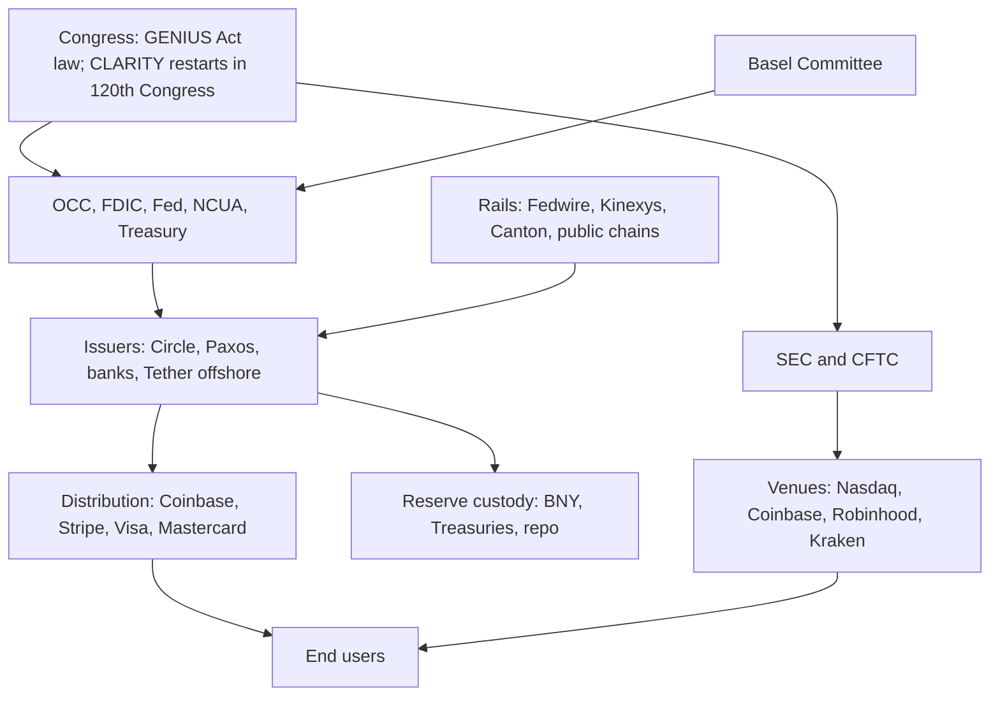

# Programmable Ledgers, Digital Money, and the Investment Map

Research date: 2026-11-04. Status: v1 (Phase 3 synthesis). Revisions after verification and red team are logged in `changelog.md`.

## Executive summary

**Is it happening?** Partly, and more slowly than the forecasts it is sold with.

- Fact: USD stablecoin supply is $295.1B (DefiLlama API, 2026-11-04). It is 3.0% lower than 12 months ago and 6.5% below its 2026-05-17 peak of $315.5B.
- Fact: Tokenized Treasuries and money funds are $14.25B (RWA.xyz, 2026-11-04) [Interested source]. That is 0.18% of US money fund assets of $7.90T (ICI, 2026-10-28).
- Inference: No market segment passes the rejection test in `null_hypothesis.md`. Four segments are contested: stablecoin payments, the offshore dollar, tokenized cash and wholesale repo on ledgers. Retail CBDCs and tokenized securities outside cash remain mostly narrative. [Moderate]

**How likely?** Lead estimate, the average of the model and WS3's judgment:

| Scenario | 2030 | 2035 | What it means |
|---|---|---|---|
| Bear | 57% | 53% | Stablecoins stay crypto plumbing and an offshore dollar. Tokenization stays a niche. |
| Base | 36% | 38% | Regulated stablecoins go mainstream. Tokenized Treasuries become standard collateral. Ledgers carry a minority of wholesale flows. |
| Bull | 7% | 9% | Ledgers become a primary settlement layer. |

- The model's variants put 2030 Bear between 50% and 73%. [Low]
- Why Bear leads: the law is in place, but demand is flat. US market structure legislation failed cloture 49 to 50 (2026-09-15). Democrats won both chambers on 2026-11-03 (AP calls via CBS News, 2026-11-04), so that bill restarts in a new Congress. [Moderate]

**Who wins?** Owners of three things: distribution, licences and balance sheets.

- Fact: Circle paid 62% of its Q3 2026 reserve income ($409.2M of $657.6M) to distribution partners (Circle Q3 2026 results, 2026-11-04).
- Fact: Public-chain fees are small. Ethereum gross revenue was $127M in H1 2026, down 69% year on year (WS4).
- Inference: Institutional flow accrues to intermediary equity (issuers, distributors, card networks, custodians, asset managers) more than to network tokens. [Moderate]

**Top five plays per tier.** The benchmark is the 3-month T-bill at 4.21% (Federal Reserve H.15, 2026-11-02).

| Rank | Retail | Mid (accredited) | Large ($5M and up) |
|---|---|---|---|
| 1 | T-bills, plus Franklin BENJI as a small tokenized-cash position (R-27, R-26) [Moderate] | Tokenized private credit funds (M-08) [Low] | Anchor position in a tokenized MMF launch (L-03) [Low] |
| 2 | Visa and Mastercard (R-09, R-10, A-01, A-02) [Moderate] | Tokenized Treasuries and MMFs for qualified investors as collateral cash (M-09) [Low] | Buy a licensed stablecoin issuer rather than build one (L-02) [Low] |
| 3 | BNY (R-12) [Low] | Ripple secondary at a discount to its tender price (M-02) [Low] | Custody infrastructure, build or buy (L-06) [Low] |
| 4 | BlackRock and ICE (R-18, R-16) [Low] | Kraken secondary, only if the Forge mark is confirmed (M-01) [Low] | Tokenized-deposit partnership with Kinexys or Citi Token Services (L-05) [Unverified] |
| 5 | Circle, sized as an option on adoption and rates (R-01) [Low] | Anchorage private round (M-04) [Low] | Block positions in CRCL or COIN only on drawdowns (L-09) [Low] |

**Recommendation.** For the theme, prefer incumbents that capture the flows without depending on it. Treat issuers and token exposure as small options. The Bull case is real enough to own a little of, and not likely enough to build a portfolio on. [Moderate]

---

## 1. Adoption: what the data show (WS0)

| Measure | Value | Date | Legacy comparator | Penetration | Source | Confidence |
|---|---|---|---|---|---|---|
| USD stablecoin supply | $295.1B | 2026-11-04 | US MMF assets $7.90T | 3.7% | DefiLlama API; ICI | [High] |
| Real stablecoin payments | $0.39T annualized | 2025-12 | ACH $93.0T (2025) | 0.4% | McKinsey/Artemis via secondary [Interested source]; Nacha | [Moderate] |
| Visa-adjusted stablecoin volume | $12.0T (raw $63.0T) | 2026-01 to 08 | | | Visa/Allium via secondary [Interested source] | [Low] |
| Tokenized Treasuries and MMFs | $14.25B | 2026-11-04 | US MMF assets $7.90T | 0.18% | RWA.xyz [Interested source]; ICI | [Moderate] |
| Tokenized stocks | $3.89B distributed | 2026-11-04 | | | RWA.xyz | [Moderate] |
| Broadridge DLR repo | about $359B per day | 2026-09 | | | Broadridge, self-reported [Interested source] | [Low] |
| Kinexys | over $7B per day | 2026-06 | RTP about the same daily value | | JPMorgan via CoinDesk [Interested source] | [Low] |
| FedNow plus RTP | about $0.99T | Q3 2026 | | | Federal Reserve; The Clearing House | [Moderate] |

- Inference: The two adjusted measures of stablecoin payments differ by about 46x. Adoption claims built on any single dashboard are therefore unreliable. [High]
- Inference: The comparison that matters is not ledger against ledger. Ledgers compete with fast conventional rails: FedNow, RTP, Pix and UPI (25.47B transactions in 2026-10, NPCI via Inc42). These deliver speed and 24/7 operation without new ledgers (null hypothesis N5). [Moderate]

## 2. Landscape (WS1)

| Category | Status | Example and latest metric | Binding constraint |
|---|---|---|---|
| Payment stablecoins | Live | USDC $73.9B (2026-09-30, Circle Q3) | Demand outside crypto trading |
| Offshore stablecoins | Live | USDT $177.8B (2026-11-04, DefiLlama) | Reserve quality: the Fed's FEDS Note (2026-04-08) puts only about 0.74x of liabilities in high-quality assets |
| Tokenized MMFs | Live | BUIDL $1.97B; BENJI and iBENJI $2.7B (RWA.xyz, 2026-11-04) | Small yield edge over conventional money funds |
| Tokenized equities | Live, small | $3.89B; SEC innovation exemption 2026-09-17 to 2031-09-17 | Settlement still runs T+1 through NSCC/DTC (Nasdaq rules approved 2026-03-18) |
| Wholesale DLT | Pilot to live | Agora is a prototype (BIS, 2026-05-27). Swift's ledger settles finally through existing systems (2026-07-09). | Interoperability and settlement finality in central bank money |
| Retail CBDC | 3 launched, 41 pilots | Atlantic Council tracker, 2026-05 | Political opposition (US anti-CBDC bill); weak usage |
| Agentic payments | Live, early | x402: $42M settled cumulatively; October 2026 run rate about $274k per month | Consumer protection and liability rules (WS8) |

- Inference: Programmability is mostly prototype in settlement. Live conditional settlement and delivery-versus-payment exist only inside single-operator systems (Kinexys, DLR) or in DeFi. [Moderate]

## 3. Who sets the rules and builds the rails (WS2)

| Item | Status (2026-11-04) | Source | Confidence |
|---|---|---|---|
| GENIUS Act | Public Law 119-27, signed 2025-07-18, effective 2027-01-18 | govinfo | [High] |
| OCC GENIUS final rule | Issued 2026-10-21. Dropped the presumption that affiliate or white-label yield is prohibited, so the ban binds issuers only. | OCC Bulletin 2026-50 | [High] |
| Fed GENIUS rules | Proposed 2026-09-24. Comments close 2026-11-30. The proposal keeps an affiliate-yield presumption. | Federal Register via Arnold & Porter | [Moderate] |
| CLARITY Act | Passed the House 294 to 134; Senate Banking Committee 15 to 9; cloture failed 49 to 50 (2026-09-15) | Latham tracker; Orrick | [High] |
| 2026 midterms | AP called both chambers for Democrats | CBS News, NBC, Forbes live coverage, 2026-11-04 | [Moderate] (seat counts provisional) |
| SEC tokenized-stock exemption | Release 34-106402, expires 2031-09-17 | SEC; Sidley | [Moderate] |
| Basel crypto standard | In force 2026-01-01; under targeted review, with an update due by end 2026 | BIS, 2026-10-01 | [High] |
| Digital euro | Parliament voted 416 to 169 to open trilogue (2026-07-09); ECB target 2029 | Secondary | [Moderate] |
| MiCA | Transition period for crypto service providers ended 2026-07-01 | Secondary | [Moderate] |

- Gap: The UK, Hong Kong licensees, Singapore, Japan, the PBoC, the SNB and private-institution financials were not verified (search cap). `institutions.csv` rows tagged Unverified are placeholders.

## 4. Timeline and scenarios (WS3, Phase 2 model)

**Calibration.** WS3 recalibrated the 2030 bands: Bear S below $500B and T below $100B; Bull S above $1.5T and T above $500B. The schema's original Bull threshold needed T to grow 149% a year. 2035 bands are unchanged.

**Model results** (`scenario_model.py`, `scenario_results.csv`):

| Run | 2030 Bear / Base / Bull | 2035 Bear / Base / Bull |
|---|---|---|
| Model base (blend growth, decay 0.8, midterm override) | 64 / 28 / 7 | 67 / 26 / 7 |
| 36-month growth, decay 0.9 (most bullish variant) | 52 / 36 / 12 | 53 / 36 / 11 |
| 12-month growth, decay 0.8 (most bearish variant) | 73 / 22 / 5 | 68 / 26 / 6 |
| Drivers only, no momentum | 54 / 35 / 11 | 53 / 36 / 11 |
| WS3 judgment | 50 / 43 / 7 | 38 / 51 / 11 |
| **Lead estimate** (model base and WS3 averaged) | **57 / 36 / 7** | **53 / 38 / 9** |

- Inference: The two most influential drivers are regulatory clarity and end-user demand. Each moves 2030 Bear by about 3.6 points per notch on the scoring scale. Basel capital treatment and political durability come next. [Moderate]
- Inference: Measured momentum drives the result more than any single policy driver. A return to the 36-month growth rate (33% a year for stablecoins) would move 2030 Bear down 9 to 12 points, depending on the decay assumption. [Moderate]

**Leading indicators and falsifiers** (WS3):

| Scenario | Indicator to watch | Falsifier |
|---|---|---|
| Bear | DefiLlama stablecoin supply below $350B on 2027-12-31 | Two measures above Base floors by 2028-12-31 |
| Base | RWA.xyz tokenized Treasuries above $30B on 2027-12-31; final FDIC and Fed GENIUS rules by 2027-07-18 | S below $400B and T below $60B on 2028-12-31 |
| Bull | Stablecoins above $600B by 2028-06-30; Basel removes the penalty for permissionless chains | S below $600B on 2028-12-31 |

**Forecast reconciliation.**
- Fact: Sell-side marks include Standard Chartered at $2T of stablecoins by 2030 (moved from 2028), Citi at $5.5T tokenized by 2030 and BCG/Ripple at $18.9T by 2033. All come from parties with an interest in the thesis [Interested source].
- Inference: These marks need 50% to 150% annual growth from today's levels. WS3's own range is about $450B to $1.1T of stablecoins and $100B to $300B of tokenized assets by 2030. [Low]

**Analogs.**
- Inference: Pix and UPI reached mass adoption in three to four years because central banks mandated or subsidized them. Value went to distributors and users, not to the rail operators.
- Inference: The 2016 to 2020 consortium wave (we.trade, TradeLens, ASX CHESS replacement) failed. The base rate for voluntary infrastructure migration without a mandate is poor. [Moderate]

## 5. Where value accrues (WS4)

| Layer | Who wins | Pricing power 2030 | Confidence |
|---|---|---|---|
| Issuance and float | Tether (offshore), Circle (regulated); bank issuers entering | Medium. Float income falls with policy rates, and distribution partners take the majority. | [Moderate] |
| Distribution and wallets | Coinbase, Stripe, card networks, Robinhood | High | [Moderate] |
| Custody and reserves | BNY, State Street, Anchorage | Medium. Licences are the moat, but fees are compressing. | [Low] |
| Settlement and clearing | DTCC, Broadridge, Canton, Kinexys | Medium | [Low] |
| Public L1 and L2 chains | Ethereum (47% of stablecoins), Tron (32%), Base | Low for tokens. Base's sequencer margin accrues to Coinbase equity. | [Moderate] |
| Tokenization platforms | Securitize, Ondo, Figure | Low to medium. The products commoditize; distribution decides the winners. | [Low] |

- Fact: A 100 basis point cut removes about $739M of Circle's gross reserve income (about $276M after distribution costs) and $1.3B to $1.8B from Tether (WS4 arithmetic from Q3 2026 data).
- Fact: The Fed target range is 3.75% to 4.00% (FOMC, 2026-10-28). [High]
- Inference: Issuer equity is mainly a rate bet layered on an adoption bet. Its return should be judged on both. [Moderate]
- Fact: Fee pools at risk by 2030 are modest. Cross-border revenue is $293B (McKinsey, 2024) [Interested source], with 1% to 4% at risk. US card swipe fees are $198B (2025, Nilson via the Merchants Payments Coalition) [Interested source], with 0.5% to 2% at risk.
- Fact: Stablecoin inflows lower T-bill yields slightly: a $3.5B inflow lowers them about 0.7 basis points on impact and about 4 basis points at 10 days (BIS Working Paper 1270). [High]
- Inference: The reserve demand matters for the front end of the Treasury curve at the margin, not for the system. [Moderate]

## 6. The plays (WS5, WS8, WS9; merged with WS7 tax)

The matrix has 75 rows in `plays.csv` and `plays.xlsx`: Retail 51, Mid 13, Large 11. Every row has a return method, a kill criterion, a tax character and a stress drawdown.

**Ranking method** (assumptions P3-1 to P3-4).
- Scenario-weighted return = P(Bear) x band low + P(Base) x band midpoint + P(Bull) x band high.
- Risk-adjusted score = (scenario-weighted return minus 4.21%) / stress drawdown.
- The band midpoint is shown as well. Wide bands score well on the midpoint and poorly on scenario weighting. That gap is itself the finding: those plays are bets on Bull or on token prices, not on the adoption evidence.

**Valuation check** (WS5, `data/valuations.csv`, stockanalysis.com, 2026-11-04):

| Ticker | Price | Market cap | Multiple | Note |
|---|---|---|---|---|
| CRCL | $76.51 | $19.5B | EV/S 5.9; forward P/E 60.8 | Reverse DCF needs about 16% revenue CAGR for a 10% return. 83% below its intraday peak. |
| COIN | $151.86 | $40.2B | EV/S 7.0; forward P/E 104.5 | Q3 revenue down 35% year on year (10-Q) |
| HOOD | $87.63 | $78.9B | EV/S 15.1; forward P/E 32.2 | The most richly priced crypto-exposed name. Crypto revenue fell 55%. |
| V / MA | $433.90 / $670.43 | $807B / $584B | Trailing P/E about 35 | Agentic and stablecoin optionality is not priced as a separate driver |
| BK | $151.55 | $102B | Forward P/E 14.9 | Reserve custody and tokenized fund servicing |

- Inference: The thesis is not priced in at crypto equities after a 68% to 83% drawdown. But their reverse-DCF hurdles still assume crypto activity recovers. Card networks price in their core franchise, not the theme. [Moderate]
- Inference: Picks-and-shovels caution applies. Tokenization platforms, custody and chain blockspace are commoditizing. Distribution, regulatory licences and balance sheet are the layers that hold pricing power. [Moderate]

**Stablecoin yield for US retail (2026-11-04).**
- Fact: GENIUS bars issuers from paying interest. Exchange rewards are not barred by the statute or by the OCC final rule.
- Fact: Coinbase advertised about 4.0% in Q1 2026 (third-party, eco.com) [SEO-shaped], and rates vary by account type (Coinbase help page).
- Inference: That reward is a discretionary marketing payment, not a claim on reserves. It is taxed as ordinary income federally and in California. It carries exchange counterparty risk, as the Binance breach of about $6.3B on 2026-10-29 showed (Bloomberg, CNBC, 2026-10-29). It is not a substitute for a T-bill, which is state tax exempt. [Moderate]

## 7. Risks (WS6, `risks.csv`, 45 rows)

| Risk | 5-year probability | Severity (1 to 5) | Hits hardest | Trigger |
|---|---|---|---|---|
| Single exchange or custodian theft above $500M | 80% | 4 | Exchange equities, retail on platforms | Any incident above $500M |
| Crypto equities fall further than BTC | 85% | 4 | COIN, HOOD, CRCL | COIN drawdown above 2x BTC's on a 60-day basis |
| BTC at or below $63,000 at some point | 70% | 4 | Token ETPs, crypto equities | BTC closes below $63,000 |
| Yield-sharing coalitions compress issuer take rate by over 25% | 65% | 4 | CRCL | Distribution costs above 62% of reserve income |
| Yield ban extended to exchanges and affiliates | 55% | 4 | CRCL, COIN | Any final rule or statute barring affiliate yield |
| Policy reversal after 2028 | 35% | 4 | Agency-dependent plays | SEC majority change; reversal of the exemption |
| USDT reserve event (USDT below $0.97 for more than 24 hours) | 10% | 5 | Whole stablecoin complex | USDT below $0.99 for 24 hours |

- Fact: Hack losses were $2.2B in 2024 and $3.4B in 2025 (Chainalysis) [Interested source]. In 2026 they are about $8.6B to $8.74B through 2026-10-31 (PeckShield, DefiLlama via Yahoo Finance). [Moderate]
- Fact: Prior-cycle drawdowns were BTC -77% to -86%, ETH -82% to -94%, COIN -92% and HOOD -92% (`data/drawdowns.csv`; pre-2025 rows tagged Unverified).

> Sizing warning: a sleeve with more than about 45% in crypto equities or tokens can breach a 40% drawdown limit in a correlated stress year (0.45 x 90% = 40.5%). Size on equity drawdown history (80% to 92%), not on BTC's.

## 8. Tax (WS7, `tax_matrix.csv`)

| Item | Status (2026-11-04) | Confidence |
|---|---|---|
| Wash sale rule (Sec. 1091) | Covers stock and securities only. Direct crypto is outside it. H.R. 10357 passed Ways and Means 38 to 5 (2026-09-16) but is not law. | [High] `[Verify with CPA]` |
| Wash sale and spot ETP shares | ETP shares are securities, so the rule likely applies (lead inference) | [Low] `[Verify with CPA]` |
| Form 1099-DA | Gross proceeds reported for sales after 2025. Basis reported only for covered units bought after 2025 in the same account. | [High] |
| Staking ETPs | Rev. Proc. 2026-20 (2026-10-06) superseded Rev. Proc. 2025-31. Rewards are ordinary income to holders. | [Moderate] `[Verify with CPA]` |
| QSBS | Stock issued after 2025-07-04: 50%, 75%, 100% exclusion at 3, 4, 5 years; $15M cap. California does not conform. Secondary purchases do not qualify (Sec. 1202 requires original issuance). | [High] federal |
| California | Taxes capital gains as ordinary income (top 13.3%). Treasury interest is exempt. | [Moderate] |

## 9. Agentic payments (WS8)

- Fact: All major payments incumbents have shipped agent products. Visa and Mastercard both say volumes are small (Q3 calls, 2026-10-28 and 2026-10-29). OpenAI shut ChatGPT Instant Checkout on 2026-03-20 (CNBC).
- Inference: Cards win consumer checkout by agents over 1 to 3 years, because chargebacks and Regulation E and Z protections sit on card rails. Stablecoins win machine-to-machine micropayments, a pool worth about $3M a year at today's run rate. [Moderate]

## 10. Geography (WS9)

| Group | Jurisdictions | Basis | Confidence |
|---|---|---|---|
| Possible outsized returns | South Korea (EWY), Kazakhstan (KSPI), Brazil (EWZ, NU) | Low multiples plus a regulatory catalyst. Brazil's real fell about 12% on 2026-10-26 (Al Jazeera). | [Low] |
| Likely losses | Argentina, Nigeria, Russia (not investable for US persons) | Capital controls, repatriation history, sanctions | [Low to Moderate] |

- Inference: These are macro and equity bets with a thin link to programmable money. Under scenario weighting they score below T-bills. [Low]

## 11. Who benefits most, and how to be among them

| Winner type | Why | How an investor participates | How a firm becomes one |
|---|---|---|---|
| Distribution owners (Coinbase, Stripe, card networks) | They take the majority of float economics and set user defaults | Public equity: V, MA, COIN; private: Stripe | Own end-user relationships and wallet defaults |
| Licensed balance sheets (BNY, large banks) | GENIUS, OCC charters and Basel favor regulated holders of reserves | BK, JPM | Obtain a charter, a reserve custody mandate and compliance at scale |
| Large asset managers (BlackRock, Franklin) | Tokenized funds extend existing distribution at low marginal cost | BLK, BEN | Shelf registration plus transfer-agent tech |
| Offshore float holders (Tether) | Highest rate times largest supply | Not investable | n/a |
| Network tokens | Weak capture so far: fees are low and leak to L2s and intermediaries | ETH or SOL via ETP, as a small option | n/a |

- Recommendation: To be among the winners as an investor, own the toll collectors on the regulated path, and keep a small, sized option on the open-network path. As a firm, the minimum kit is a licence, reserve custody, distribution and a compliance team. WS5 rows L-01 to L-08 give a breakeven for an issuer of about $2.65B of supply against an assumed $40M a year of operating cost. [Low]

## 12. Monitoring plan

**Catalyst calendar**

| Date | Event | Watch for |
|---|---|---|
| 2026-11-30 | Fed GENIUS comment period closes | Whether the affiliate-yield presumption survives |
| 2026-12-09 | FOMC | Rate path: issuer float income |
| 2026-12-31 | Basel crypto review update due; EU digital euro target | Treatment of permissionless chains |
| 2027-01-03 | 120th Congress convenes; CLARITY must be reintroduced | Democratic market-structure posture |
| 2027-01-18 | GENIUS Act effective | Count of OCC-approved issuers |
| 2027-07-18 | Target date for final FDIC and Fed rules | Rule finality |
| 2027-10-11 | EU, UK, Switzerland move to T+1 | Settlement modernization without DLT |
| 2027-12-31 | WS3 test date | Stablecoins above $350B? Tokenized Treasuries above $30B? |
| 2028-07-18 | GENIUS 3-year deadline for non-permitted stablecoins | USDT's US access path |
| 2028-11-07 | US presidential election | Durability of agency-made policy |

**Indicator dashboard**

| Indicator | Source | Bear trigger | Bull trigger |
|---|---|---|---|
| USD stablecoin supply | stablecoins.llama.fi | Below $280B | Above $400B |
| Tokenized Treasuries and MMFs | app.rwa.xyz/treasuries | Below $12B | Above $30B |
| Circle distribution cost ratio | Circle 10-Q | Above 65% | Below 55% |
| BTC drawdown from $126,080 | CoinMarketCap | Below -50% | New high |
| Monthly hack losses outside the largest incident | DefiLlama hacks | Above $1B | n/a |
| Fed funds target | federalreserve.gov | n/a | n/a (affects issuer revenue) |

## 13. Dissent and weaknesses

To be filled verbatim after the Phase 5 red team (see `ws/redteam_a.md`, `ws/redteam_b.md`).

Known weaknesses (lead):
1. **Search caps cut evidence short.** Every workstream hit a per-agent search cap between 11 and 30 searches against a budget of 40. Many rows rest on secondary sources.
2. **Return bands are uncalibrated.** Workstream bands are not calibrated distributions, and their lows mix one-year stress with annualized returns. Scenario weighting is therefore conservative for wide bands, and midpoints are optimistic.
3. **No wholesale share measure.** There is no verified W series (share of wholesale flows on DLT). The scenario assignment rests on S and T only.
4. **The model is judgment.** Its weights and slopes are stated in `assumptions.md` P2-1 to P2-12.

## Sources and process

- `sources.md` (279 unique URLs with bias notes)
- `search_log.md`
- `assumptions.md`
- `verification.md`
- `changelog.md`
- `ws/ws0.md` to `ws/ws9.md` (raw workstream output)

This is research, not individualized financial, legal, or tax advice, and the reader should verify current facts and consult licensed advisors before acting.
