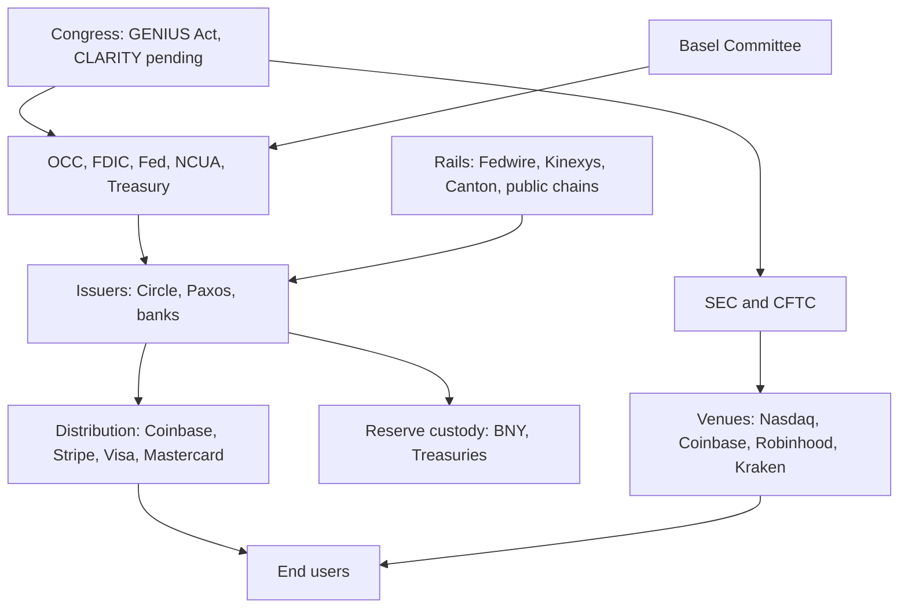

# WS2: Who: institutions, governments, regulators, and the political map (core jurisdictions)

## Summary
Fact: the GENIUS Act (Public Law 119-27) was signed 2025-07-18 and takes effect 2027-01-18, the statutory 18-month backstop. The OCC issued its final implementing rule on 2026-10-21, effective 2027-01-18. The Fed proposed its rules on 2026-09-24 (comments close 2026-11-30). FDIC, NCUA and Treasury remain at proposal stage in the sources I could verify.

Fact: the OCC final rule dropped the proposed rebuttable presumption that would have treated issuer payments to affiliates or white-label partners as prohibited yield. The statutory ban covers issuers only. Exchange or affiliate rewards are therefore not banned by the GENIUS text or the OCC rule, and the fight moved to the CLARITY Act.

Fact: the CLARITY Act (H.R. 3633) passed the House 294-134 on 2025-07-17. The Senate Banking Committee advanced its version 15-9 on 2026-05-14. Senate cloture on the motion to proceed failed 49-50 on 2026-09-15. Tillis entered a motion to reconsider. Passage this Congress is widely viewed as unlikely. Live reports on 2026-11-04 say Democrats won the Senate and House in the 2026-11-03 midterms [Moderate, uncalled races remain].

Fact: the SEC issued a tokenized NMS stock "innovation exemption" order on 2026-09-17, running to 2031-09-17. Basel's crypto standard review is unfinished; an update is due by end 2026. The digital euro cleared the European Parliament vote to open trilogues (2026-07-09); ECB target is 2029.

Limitation: the shared web search cap was exhausted after about 15 searches. UK, Hong Kong licences, Singapore, Japan, PBoC, SNB, BoJ, and most private-institution financials were NOT verified this session. They are marked [Unverified] and must not drive conclusions.

## Key numbers
| Metric | Value | Date | Source | Confidence |
|---|---|---|---|---|
| GENIUS Act public law | Public Law 119-27 (S. 1582) | 2025-07-18 | govinfo PLAW-119publ27 | [High] |
| GENIUS effective date | 2027-01-18 (earlier of 18 months after enactment or 120 days after final regs) | stat. text | govinfo Sec. 20; OCC final rule | [High] |
| OCC GENIUS final rule | Issued 2026-10-21, effective 2027-01-18, about 328 comments | 2026-10-21 | OCC Bulletin 2026-50; rule text | [High] |
| Fed GENIUS proposals | Two NPRMs 2026-09-24; FR 2026-09-29; comments to 2026-11-30 | 2026-09-29 | Arnold & Porter 2026-10 | [Moderate] |
| CLARITY House vote | 294-134 | 2025-07-17 | Latham tracker; Orrick | [High] |
| CLARITY Senate Banking vote | 15-9 | 2026-05-14 | Latham tracker; Senate Banking | [High] |
| CLARITY Senate cloture | Failed 49-50 | 2026-09-15 | Orrick 2026-10 and others | [Moderate] |
| SEC tokenized stock exemption | Release 34-106402; expires 2031-09-17; caps 75/250 symbols | 2026-09-17 | SEC PR 2026-90; Sidley | [Moderate] |
| SEC Regulation Crypto Assets | Proposed 2026-08-18; comments closed 2026-10-20 | 2026-08-18 | Orrick; ETF issuer filings | [Moderate] |
| Digital euro | EP plenary 416-169-22 to open trilogue; ECB target 2029 | 2026-07-09 | Sofia Globe (secondary) | [Moderate] |
| MiCA CASP transition | Ended 2026-07-01 (no extension beyond) | 2026-07-01 | Elliptic, Deloitte Legal (secondary) | [Moderate] |
| UCC Article 12 | About 33 jurisdictions (incl. NY, signed 2025-12-05) | 2026 | Alston; Wolters Kluwer | [Low] |
| Basel crypto standard | In force 2026-01-01; targeted review, update by end 2026 | 2026-10-01 | BIS release 2026-10-01 | [High] |

## Body

### 1. US law: GENIUS Act and implementing rules
| Label | Item | Status | Source |
|---|---|---|---|
| Fact | Statute | Public Law 119-27, signed 2025-07-18. Senate 68-30 (2025-06-17), House 308-122 (2025-07-17). | govinfo; Latham tracker |
| Fact | Effective date | Sec. 20: earlier of 18 months after enactment (2027-01-18) or 120 days after primary regulators issue any final regulations. The OCC fixed 2027-01-18. | govinfo Sec. 20; OCC rule |
| Fact | OCC | Proposed 2026-03-02 (91 FR 10202), second notice 2026-06-24, FINAL 2026-10-21. New 12 CFR Part 15. BSA/AML and OFAC excluded (separate Treasury rulemaking). | OCC Bulletin 2026-50 |
| Fact | FDIC | Proposals 2025-12-19 and 2026-04-10 (91 FR 18534). Would deny pass-through insurance to stablecoin holders. Tokenized deposits are deposits. No final rule found. | FDIC; Mayer Brown 2026-04 |
| Fact | Federal Reserve | Two NPRMs 2026-09-24 (91 FR 61346, 61580). Comments close 2026-11-30. | Arnold & Porter 2026-10 |
| Fact | NCUA | Proposals 2026-02-12 and 2026-05-18. No final found. | Arnold & Porter 2026-10 |
| Fact | Treasury | State-regime equivalence proposal 2026-04-03; issuance and offering proposal 2026-08; OFAC/FinCEN proposal 2026-04-10. | Arnold & Porter 2026-10 |
| Inference | The 2026-07-18 statutory rulemaking deadline was missed by most agencies; the effective date still arrives by statute on 2027-01-18. [Moderate] | | |

### 2. Stablecoin yield prohibition (load-bearing)
| Label | Item | Detail |
|---|---|---|
| Fact | Statutory text, Sec. 4(a)(11) | Issuers may not pay "the holder of any payment stablecoin any form of interest or yield (whether in cash, tokens, or other consideration) solely in connection with the holding, use, or retention of such payment stablecoin." Applies to permitted and foreign payment stablecoin issuers. (OCC final rule quoting 12 U.S.C. 5903(a)(11); govinfo.) [High] |
| Fact | Scope | The ban binds the issuer. The OCC says it does not reach deposits, including tokenized deposits, because the definition of payment stablecoin excludes deposits (OCC rule, 2026-10-21). [High] |
| Fact | Affiliate extension, proposed | OCC 2026-03 proposal: rebuttable presumption that payments by an issuer to an affiliate, related third party or white-label partner who pays holders violate the ban. Fed 2026-09-24 proposal has a similar presumption and invites comment. [High] |
| Fact | Affiliate extension, final | The OCC final rule ELIMINATED the rebuttable presumption in 15.10(c)(4), citing the statute's lack of an indirect-payment clause and anti-evasion authority limits. It says it will revisit if Congress amends the Act. [High] |
| Fact | Legislative attempt | Senate Banking text (Tillis-Alsobrooks, 2026-05-01; bill text 2026-05-12) bars service providers from paying yield on idle balances while allowing activity-based rewards. Exact operative text not fetched. [Moderate] |
| Inference | Until CLARITY or a Fed/FDIC rule says otherwise, exchange-paid rewards on USDC-type balances stay outside the statute and OCC rule. The Fed rule is the main residual risk. [Moderate] |
| Recommendation | WS5 and WS7: treat retail stablecoin rewards as legally exposed to a Fed final rule and to CLARITY, kill criterion is a Fed final rule with an affiliate presumption. [Moderate] |

### 3. US market structure, anti-CBDC, SEC and CFTC
| Label | Item | Status |
|---|---|---|
| Fact | CLARITY Act (H.R. 3633, Digital Asset Market Clarity Act) | House 294-134 on 2025-07-17. Senate Banking text released 2026-05-12, advanced 15-9 on 2026-05-14, placed on calendar (No. 423) on 2026-06-01. Cloture on motion to proceed failed 49-50 on 2026-09-15 (all 49 yes were Republicans; Collins, Hawley, Moran, Tillis voted no). Reconsideration motion entered. [Moderate: secondary reports of the tally] |
| Fact | Senate Agriculture bill | Digital Commodity Intermediaries Act (S. 3755 per Latham) advanced 12-11, party line, 2026-01-29. Not merged. |
| Fact | Anti-CBDC | CBDC Anti-Surveillance State Act (H.R. 5403 per Latham; H.R. 1919 per Congress.gov search results) passed House 219-210 on 2025-07-17. Senate companion S. 1124 sits in Banking. No enactment found; numbering conflict unresolved. [Low] |
| Fact | SEC and CFTC | Joint Project Crypto announced 2026-01-29. Joint interpretation with five-part token taxonomy 2026-03-17. SEC Regulation Crypto Assets proposed 2026-08-18. CFTC sent rulemaking RIN 3038-AF80 to OIRA 2026-09-17. (Orrick 2026-10) [Moderate] |
| Fact | SEC innovation exemption | Order 2026-09-17: tokenized NMS stock venues exempt from "exchange", liquidity providers from "dealer", to 2031-09-17. Excludes tokenizers, clearing agency and transfer agent status, 1940 Act. Public ledger and issuer-objection conditions. (SEC PR 2026-90) [High] |
| Fact | Generic listing standards | Approved by SEC September 2025 (Cointelegraph, Goodwin). Spot crypto ETPs, including staking variants, now file under them (issuer filings 2026). [Moderate] |
| Fact | Fed master accounts | Fed proposed "payment accounts" (skinny master accounts) 2026-05-20, comments closed 2026-07-27, Barr dissented, finalization expected by end 2026. Kraken reportedly got a 12-month limited account (date conflicts: 2026-01-28 or 2026-03-04). [Low] |
| Fact | Fed leadership | A Paul Hastings tracker title reports the Senate confirmed Warsh as Fed Chair (date not fetched). [Unverified] |

### 4. Bank capital, accounting, state law
| Label | Item | Status |
|---|---|---|
| Fact | Basel SCO60 | In force in the Basel Framework from 2026-01-01. Committee agreed 2025-11-19 to expedite a targeted review; BIS 2026-10-01: "advanced its review and expects to provide an update by the end of the year." [High] |
| Conflict | An ISDA letter (2026-05-15) refers to an April 2026 Basel paper on permissionless chains. BIS releases show no such consultation. Treat as unconfirmed. [Low] |
| Fact | FASB ASU 2023-08 | Not re-verified this session. From memory: mandatory fair value for in-scope crypto assets, effective fiscal years after 2024-12-15. [Unverified] |
| Fact | UCC Article 12 | Secondary sources say about 33 states plus DC enacted the 2022 amendments; NY signed 2025-12-05 (effective mid-2026). Counts conflict and a state list was not obtained. ULC map not retrievable. [Low] |

### 5. EU, UK, Asia
| Label | Jurisdiction | Status |
|---|---|---|
| Fact | EU, MiCA | CASP grandfathering ended 2026-07-01; no member state period runs beyond. ESMA register counts vary (213 to about 370 depending on date and Article 60 inclusion). [Moderate, secondary] |
| Fact | EU, digital euro | ECON approved Navarrete report 43-14-1 on 2026-06-23; plenary voted 416-169-22 on 2026-07-09 to open trilogue. Holding caps and 24-month rollout reported. ECB target: 2029 issuance, possible 2027 pilots. Final law not adopted. [Moderate] |
| Fact | HK | Stablecoins Ordinance (Cap. 656) in force 2025-08-01. An HKMA release "Granting of stablecoin issuer licences" dated 2026-04-10 is referenced, contents not retrieved, licensee names unverified. [Moderate on regime, Unverified on licensees] |
| Unverified | UK | BoE systemic stablecoin regime, FCA regime, Digital Securities Sandbox: not searched. |
| Unverified | Singapore, Japan, PBoC, SNB, BoJ, BIS Agora | Not searched. Do not rely. WS3 and WS9 should treat as open. |

### 6. Private institutions by exposure
Rows are in `institutions.csv`. Almost all financial figures and IPO statuses could not be verified (search cap). Ranking is judgment.
| Label | Tier | Entities | Basis |
|---|---|---|---|
| Inference | Highest purity (public) | Circle (CRCL), Coinbase (COIN), Galaxy, Bullish, Figure, Gemini | Revenue mostly crypto or stablecoin float [Low] |
| Inference | Highest purity (private) | Tether, Ripple, Paxos, Anchorage, Fireblocks, Securitize, Ondo, Chainlink Labs, Digital Asset, R3 | Core business [Low] |
| Inference | Medium | Robinhood (HOOD), Kraken, Visa, Mastercard, Stripe, PayPal, DTCC, SWIFT, BlackRock | Material products, small share of value [Low] |
| Inference | Low purity | JPMorgan, Citi, BNY, State Street, Goldman, Morgan Stanley, HSBC, StanChart, DBS, Franklin, Fidelity, Invesco, WisdomTree, VanEck, Apollo, KKR, Hamilton Lane, Nasdaq, ICE, CME | Tokenization is a small share of earnings [Low] |
| Recommendation | Before WS4 and WS5 use any row, re-verify with the latest 10-Q or 10-K. Mark all as `confidence=Unverified` as filed. [High] |

### 7. Power map
| Function | Who (verified roles) |
|---|---|
| Rule setters | Congress; OCC, FDIC, Fed, NCUA, Treasury (GENIUS); SEC and CFTC (securities, commodities); Basel Committee; EU Parliament, Council, ECB, ESMA |
| Rail builders | Fed (FedNow, Fedwire), DTCC, SWIFT, JPMorgan Kinexys, Canton, public chains (roles per WS1) |
| Issuers | Circle, Paxos, Tether, banks (tokenized deposits), BlackRock, Franklin, Ondo, Securitize |
| Distributors | Coinbase, Robinhood, Kraken, Stripe, PayPal, Visa, Mastercard |
| Reserve holders | Custodian banks (BNY, State Street) and Treasury-market counterparties [Unverified specifics] |

### 8. Gap G14: durability beyond 2028
| Label | Policy | Reversible by | Assessment |
|---|---|---|---|
| Fact | GENIUS statute | Only a new statute (60-vote Senate) | Durable. Congress-wide support (68-30). [Moderate] |
| Fact | OCC, FDIC, Fed rules | Rulemaking by a future administration; the OCC itself says it will revise as needed | Medium. Rule detail, not the framework, can swing. [Moderate] |
| Fact | SEC exemption (to 2031-09-17) | Commission vote at any time; it is "interim" | Fragile past 2028 absent codification. [Moderate] |
| Fact | SEC and CFTC taxonomy and Reg Crypto Assets | Rulemaking or reversal of interpretations | Fragile until final. [Moderate] |
| Fact | Fed payment account | Fed Board action | Medium. |
| Inference | CLARITY failure plus a Democratic Congress from 2027-01-03 makes codification of market structure less likely and raises pressure to attach ethics terms. Reported midterm results are uncalled in places. [Low] |
| Inference | The bill dies at the end of the 119th Congress; a reintroduction would restart. [Moderate] |
| Recommendation | WS3: model a 2027-2028 window where rule-based items face both reversal and enhancement risk. Kill criterion: Fed final rule adopting an affiliate yield presumption. [Low] |

## Gaps and unresolved
- Search cap hit: UK, HK licensees, Singapore, Japan, PBoC, BoJ, SNB, BIS Agora, FASB, Fed leadership date not verified.
- All private-institution revenue, AUM and IPO statuses (Kraken, Ripple, Securitize, Anchorage, Fireblocks, Stripe) unverified.
- UCC Article 12 state list and exact count not obtained.
- Anti-CBDC bill numbering conflict (H.R. 1919 vs H.R. 5403) and any NDAA inclusion unresolved.
- Exact CLARITY yield text, FDIC/NCUA/Treasury finalization, midterm final results not confirmed.
- OCC rule text is the only primary document read in full (via pdftotext on the fetched PDF).

## Files written
- /home/user/Grotesque-Sublime/research/ws/ws2.md
- /home/user/Grotesque-Sublime/research/institutions.csv
- /home/user/Grotesque-Sublime/research/ws/search_log_ws2.md
